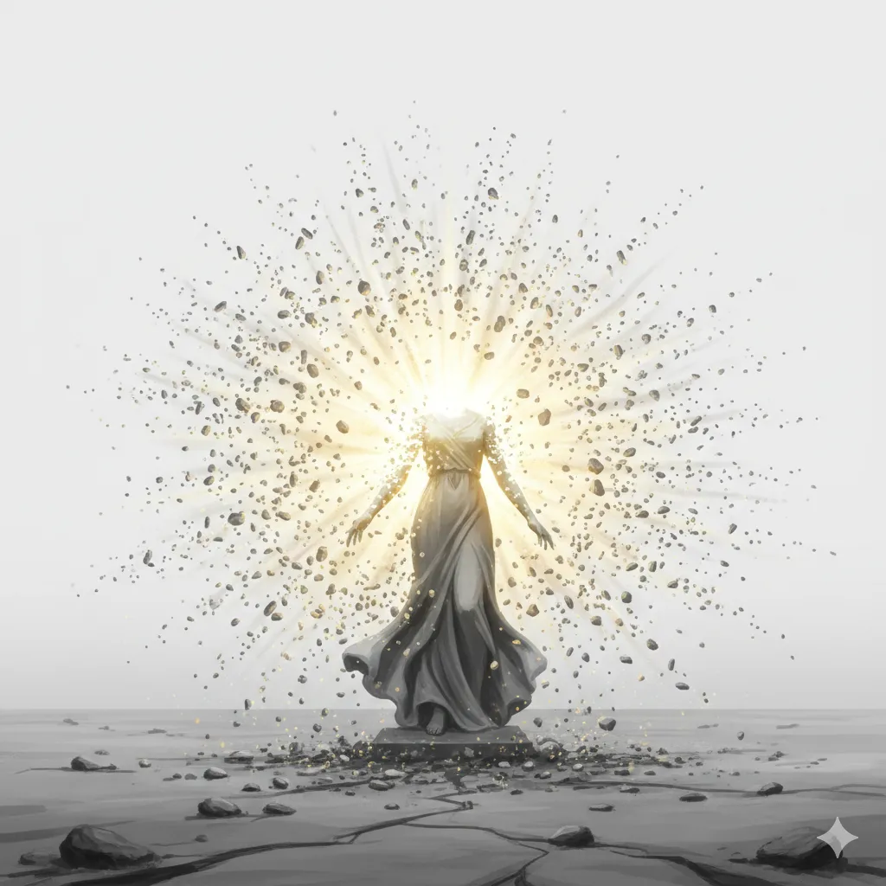

_Tytanka Piękna, Siostra Sydona i Lutherii. Uwolniona przez Versira, jej esencja spoczywa w jego rękawicy._

## Historia
Jedna z ośmiorga pierwotnych Tytanów, dzieci [[Thylea|Thylei]] i [[Kentimane|Kentimane'a]], ciotka [[Versir|Versira]]. Padła ofiarą Bliźniąt ([[Sesja 39 - Tajemnice Wyspy Złotego Serca]]): [[Lutheria]] zastawiła na nią pułapkę na [[Wyspa Złotego Serca|Wyspie Złotego Serca]], gdzie została przemieniona w kamień krwią tysiąca bazyliszków ([[Sesja 65 - Wyprawa w Otchłań]]). Trafiła do [[Hades|Hadesu]], gdzie była więziona jako kamienny posąg o twarzy wykrzywionej wiecznym przerażeniem.

Wrzucona przez Lutherię do Ojca Potworów.

W [[Sesja 60 - Typhon Symfonia Potępienia i Brama do Hadesu]] [[Versir]] ujrzał ją w wizji jako kamienny posąg w kolejce dusz nad Styksem i rozpoznał w niej swoją ciotkę, Yalę, Tytankę Piękna.

W [[Sesja 61 - Yala, Arezja i Żółw]] bohaterowie odnaleźli ją w Hadesie. Przeszli przez iluzoryczne wspomnienia raju — należała do ósemki dzieci tytanów [[Thylea|Thylei]], a jej rodzeństwo to [[Hergeron Pierwszy|Hergeron]], [[Sydon]] i [[Lutheria]]. Zniewolona wspomnieniem, dążyła do perfekcji: „Więcej treningu. Tym razem mi się uda. Będę perfekcyjna". W walce rzuciła się na bohaterów z furią uwięzionej bestii, a ich ciosy ledwo ją raniły; celem było przebudzenie, nie zabicie. Uwolniona od szaleństwa i z kamiennego posągu, powiedziała [[Versir|Versirowi]], by strachowi dawał tylko pięć sekund, a potem brał sprawy w swoje ręce. Jej esencja dobrowolnie wstąpiła do Rękawicy Versira, dołączając do [[Chalcia Pierwsza|Chalci]], by wesprzeć go w walce.

W [[Sesja 65 - Wyprawa w Otchłań]] dusza Yali, zaklęta w rękawicy, wibrowała, gdy [[Versir]] zbliżał się do sześcianu.
