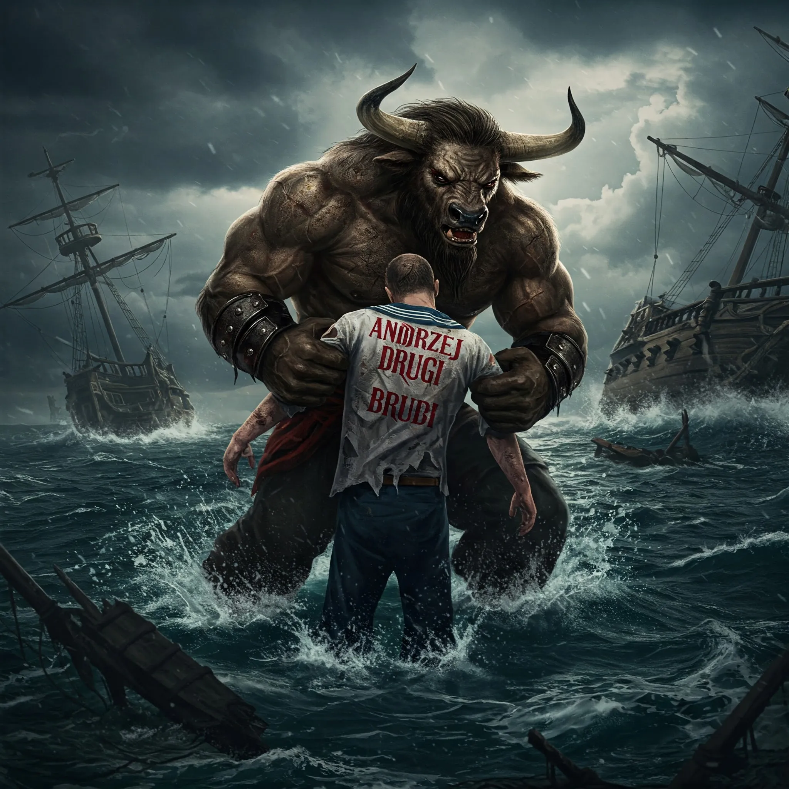

_Marynarz z załogi Ultrosa, który uległ pieśni syren, ale został uratowany._

## Historia
W [[Sesja 46 - Morderca z Wyspy Wygnańców]] Andrzej Drugi, członek załogi [[Ultros|Ultrosa]], wpadł w trans pod wpływem pieśni syren i skoczył do wody. Zahipnotyzowanego marynarza wyłowił [[Orestes]].
