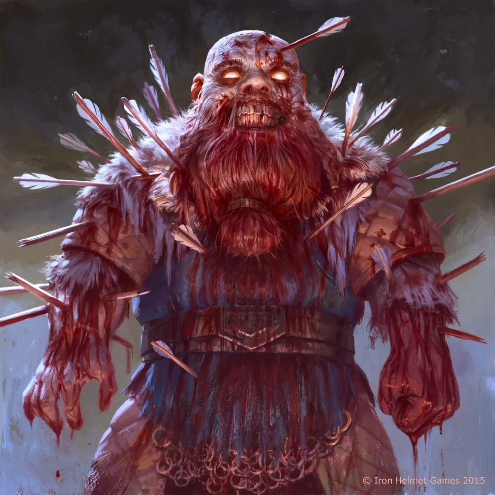

_Kwatermistrz Ultrosa, krasnolud z nieumarłej załogi. Po wyborze Orestesa opuścił statek._

## Opis
Davos to krasnolud, który służył jako kwatermistrz na statku [[Ultros]]. Jest tam od samego początku, przez około 500 lat.

## Osobowość
Lojalny wobec [[Estor Arkelander|Estora Arkelandera]]. Chętnie opowiada o historii statku i kapitanie.

## Historia
Zna historię paktu Estora z [[Lutheria|Lutherią]] oraz masakry załogi, która doprowadziła do ich nieumarłego stanu.

W [[Sesja 24 - Ultros]] opowiedział drużynie o historii powstania Ultrosa i jego związku z Estorem i Lutherią. Po śmierci Estora [[Orestes]] został nowym kapitanem i wybrał ścieżkę żywych, w wyniku czego cała nieumarła załoga, w tym Davos, opuściła statek.
