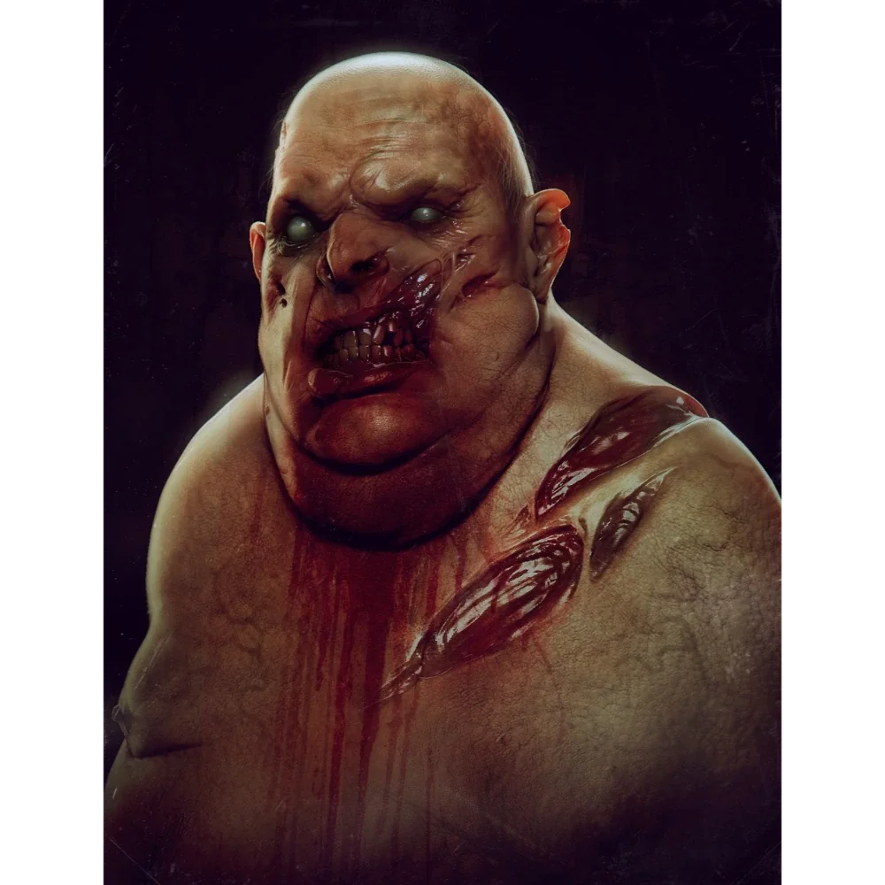

_Nawigator Ultrosa, potężnie otyły duch. Po wyborze Orestesa odszedł wraz z resztą załogi._

## Opis
Metron to duch nawigatora, wyróżniający się ogromną otyłością. Nosi tylko opaskę biodrową. Ma wielką bliznę na brzuchu, ślad po śmiertelnym ciosie zadanym przez Estora.

## Osobowość
Leniwy, tęskni za jedzeniem i snem, choć jako duch nie potrzebuje ich. Otwarty i gadatliwy, chętnie dzieli się historią swojej śmierci.

## Historia
Został zabity przez [[Estor Arkelander|Estora Arkelandera]], gdy poszedł go obudzić po brzemiennej w skutki nocy Estora z [[Lutheria|Lutherią]]. Estor, przebudzony jako potwór, rozpruł brzuch Metrona, rozpoczynając masakrę załogi.

W [[Sesja 24 - Ultros]] spotkał się z drużyną i opisał, jak Estor zawarł pakt z Lutherią i zabił całą załogę, po czym sami powstali jako duchy. Odszedł wraz z resztą załogi po tym, jak [[Orestes]], nowy kapitan, wybrał ścieżkę żywych.
