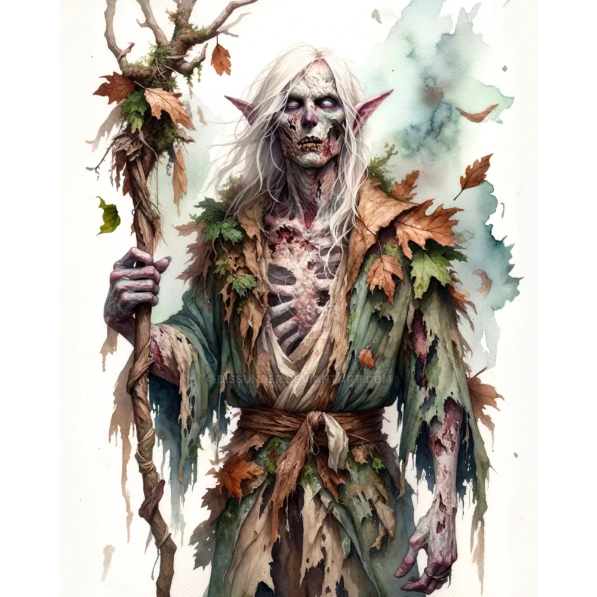

_Elf z nieumarłej załogi Ultrosa, historyk i naukowiec. Po wyborze Orestesa odszedł wraz z resztą załogi._

## Opis
Skathon to duch elfa, pełniący funkcję pierwszego oficera.

## Osobowość
Intelektualista, historyk i naukowiec. Był gotów przyjąć [[Orestes|Orestesa]] na ucznia.

Mniej zainteresowany walką, bardziej wiedzą.

## Historia
Duch jednego z thanów [[Estor Arkelander|Estora]], zamordowanego przez kapitana i związanego z jego wolą.

W [[Sesja 24 - Ultros]] zaoferował [[Orestes|Orestesowi]] naukę. Odszedł wraz z resztą załogi po tym, jak nowy kapitan wybrał ścieżkę żywych.
