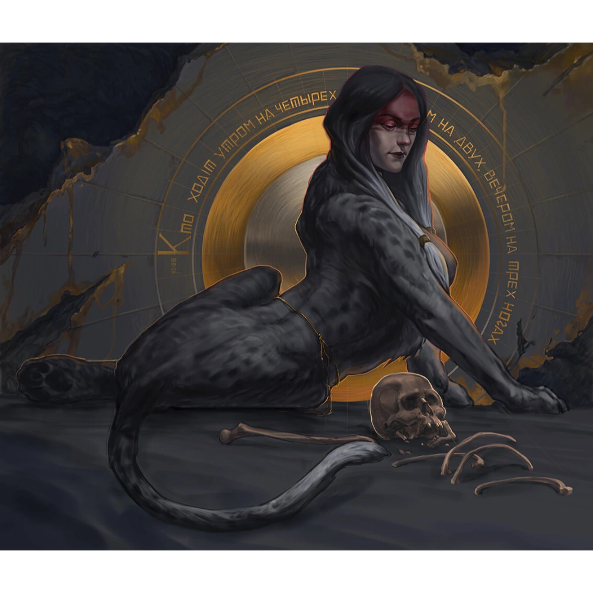

_Potężny sfinks (Gynosphinx) zamieszkujący wieżę na [[Wyspa Skorpiona]]. Zdjęła klątwę z centaurów w zamian za przeprosiny sfinksów z Wyspy Czasu._

## Opis
Majestatyczny, skrzydlaty lew z twarzą królewskiej kobiety. Zamieszkuje szczyt czarnej wieży bez okien i drzwi, której wnętrze pokryte jest wyrytymi w skale hieroglifami.

Podczas wizyty na statku [[Ultros]] w [[Sesja 59 - Koniec Imprezy]] ukazała się jako półmaterialna postać.

## Osobowość
Jest istotą o neutralnym usposobieniu (True Neutral), która nade wszystko ceni wiedzę i historię. Uważa, że ci, którzy nie znają historii, są skazani na powtarzanie jej błędów i w jej oczach są równi niemowlętom – co literalnie realizuje, zamieniając niegodnych intruzów w dzieci.

## Historia
Wiedźma Lotosu to wygnanka z [[Wyspa Czasu|Wyspy Czasu]]: jej rodzeństwo, sfinksy, wygnało ją za nadużywanie swoich mocy ([[Sesja 41 - Wiedźma Lotosu]]; w [[Sesja 59 - Koniec Imprezy]] uznano, że samo wygnanie było jak najbardziej zasadne).

Według centaurów z [[Wyspa Skorpiona|Wyspy Skorpiona]] ([[Sesja 40 - Uciechy na Wyspie Skorpiona]]) wiedźma fascynowała się wiedzą i twierdziła, że centaury kiedyś zniszczyły bibliotekę. Centaury, które osiągają dorosłość bez znalezienia jeźdźca, zmieniają się w wielkie skorpiony.

Przybyła na Wyspę Skorpiona w poszukiwaniu wiedzy zawartej w wielkiej bibliotece centaurów, wyrytej na drzewach tutejszego lasu. Kiedy centaury lekkomyślnie wycięły las na opał, niszcząc bezcenną wiedzę, wpadła w gniew i rzuciła na nich klątwę.

W [[Sesja 40 - Uciechy na Wyspie Skorpiona]] bohaterowie wyruszyli do jej [[Wieża Wiedźmy Lotosu|wieży]], przedzierając się przez magiczne pola lotosu, gdzie czas płynął nienaturalnie.

W [[Sesja 41 - Wiedźma Lotosu]] poddała bohaterów próbom, zamieniając ich w dzieci i zmuszając do pracy; z Karolem Strasburgerem poprowadziła jako gospodyni teleturniej Familiada, po którym pozwoliła bohaterom zakręcić Kołem Fortuny, obdarzającym mocami i klątwami. Ujawniła, że klątwę [[Orestes|Orestesa]] rzuciła [[Lutheria]] i że zdjąć ją można przebłaganiem lub zniszczeniem bogini; że [[Thylea]] to kieszonkowy plan odizolowany od reszty świata, a barierę można osłabić, skupiając boskie iskry w mniejszej liczbie rąk; że największą słabością [[Hexia|Hexii]] jest [[Pythor]], ojciec [[Orion Xul|Oriona]]; oraz że cząstkę duszy matki [[Versir|Versira]] zawierają odłamki Gwiezdnej Skały rozrzucone po Thylei, które musi zebrać i wchłonąć. Zażądała przeprosin od sfinksów z Wyspy Czasu, swojego rodzeństwa, w zamian za zdjęcie klątwy z centaurów.

W [[Sesja 47 - Wyspa Mojr]] przestrzegała Orestesa przed przyjmowaniem ofert od istot takich jak [[Mojry]].

W [[Sesja 59 - Koniec Imprezy]] otrzymała przeprosiny od sfinksów i zgodnie z umową zdjęła klątwę z centaurów z Wyspy Skorpiona.

W [[Sesja 84 - Świt Nowej Ery]] przypomniano, że [[Versir]] zapytał ją dawno temu, czy zostałaby nową [[Mojry|Mojrą]] — i że wstępnie była chętna. Półtytan prowadził w kolejnych latach własną, długofalową grę o obsadzenie pustych krosien losu; jako drugą kandydatkę wskazywano [[Versi|Versi Wyrocznię]].
