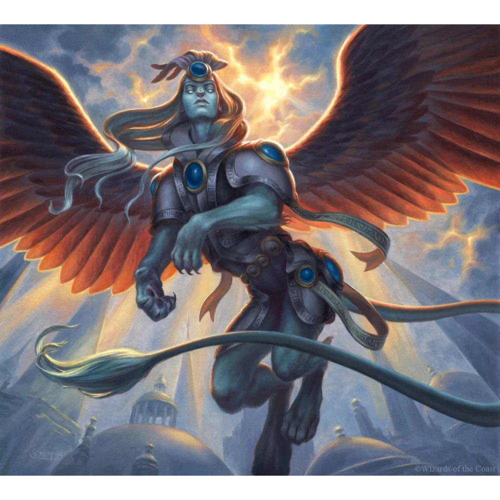

_Starsza Sfinks z Wyspy Czasu_

## Osobowość
Formalna, obiektywna.

## Historia
W [[Sesja 58 - Wyspa Czasu]] jako starsza sfinks formalnie przedstawiła bohaterom sytuację [[Kartos|Kartosa]]: bez księgi o rozstrzygnięciu zdecyduje głosowanie, albo trzeba odnaleźć dowody.

W [[Sesja 59 - Koniec Imprezy]] wyjaśniła chłodno przebieg procesu. Potrafiła znikać z pomieszczenia, a po podniesieniu księgi teleportowała wszystkich do centralnej komnaty sądu. Znalazła w [[Wielka Księga Zasad|Wielkiej Księdze Zasad]] słowo „Wiedźmin” i uznała tym samym Kartosa za niewinnego. Zezwoliła na głosowanie nad przeprosinami dla [[Wiedźma Lotosu|Wiedźmy Lotosu]], uznając, że samo wygnanie było jak najbardziej zasadne, lecz proces oparty na emocjach.
