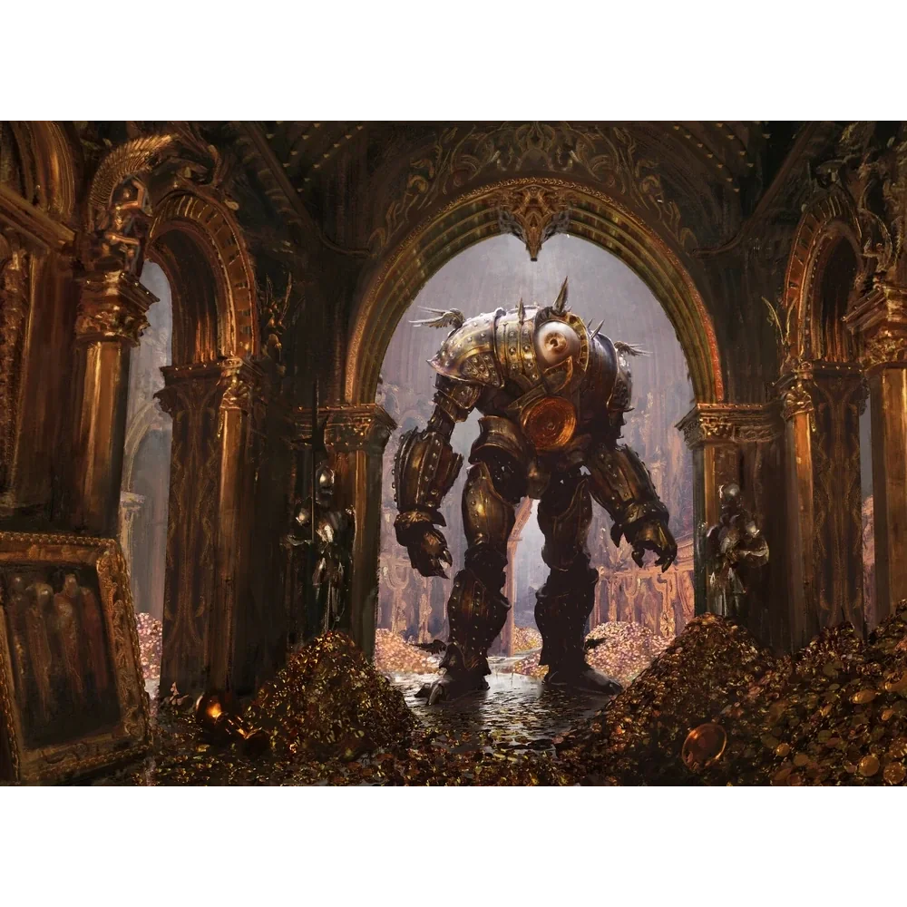

_Mechaniczny Anioł, Kat_

## Opis
Mechaniczny anioł, którego obecność była obietnicą ostateczności. Na [[Wyspa Czasu|Wyspie Czasu]] pełni funkcję kata w sądzie sfinksów.

## Historia
W [[Sesja 58 - Wyspa Czasu]] bohaterowie zobaczyli ją jako kata w procesie [[Kartos|Kartosa]].

W [[Sesja 59 - Koniec Imprezy]], gdy [[Bilatro]] znalazła w [[Wielka Księga Zasad|Wielkiej Księdze Zasad]] słowo „Wiedźmin” i Kartos został uznany za niewinnego, uwolniła go, a pochwyciła przerażonego [[Noland|Nolanda]].
