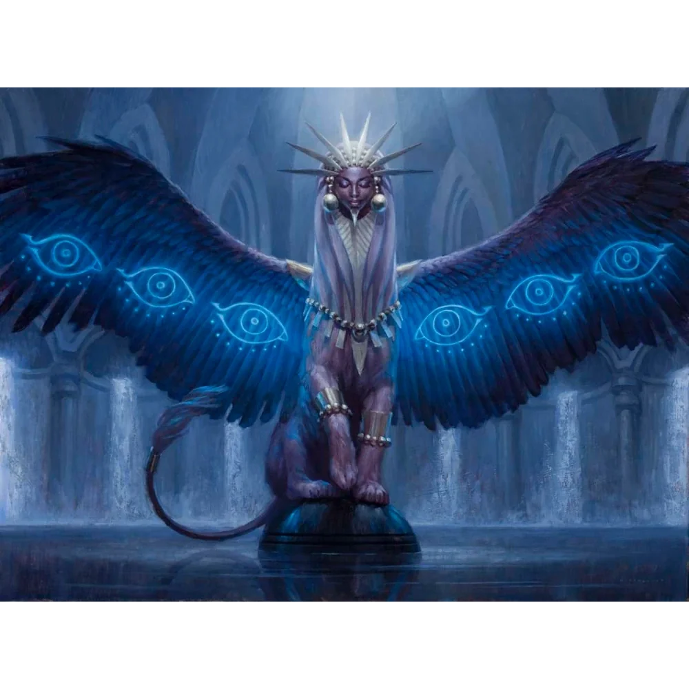

_Gynosphinx, Dawna Opiekunka Versira_

## Opis
Majestatyczna sfinks o ciele lwa i twarzy kobiety.

Gynosphinx, mieszkanka [[Wyspa Czasu|Wyspy Czasu]] i dawna opiekunka [[Versir|Versira]].

## Osobowość
Tajemnicza, mądra, opiekuńcza (względem Versira).

## Historia
W [[Sesja 58 - Wyspa Czasu]] powitała bohaterów na placu przystani i zagadkowo ostrzegła ich przed nadchodzącym sądem: „On nadchodzi. Trzy ryki ogłoszą jego sąd. Trzy i nie więcej. To jest czas, który wam przeznaczył. Wykorzystajcie go mądrze.”

W [[Sesja 59 - Koniec Imprezy]] wraz z [[Kartos|Kartosem]] i [[Waywa|Waywą]] zagłosowała za przeprosinami dla [[Wiedźma Lotosu|Wiedźmy Lotosu]].
