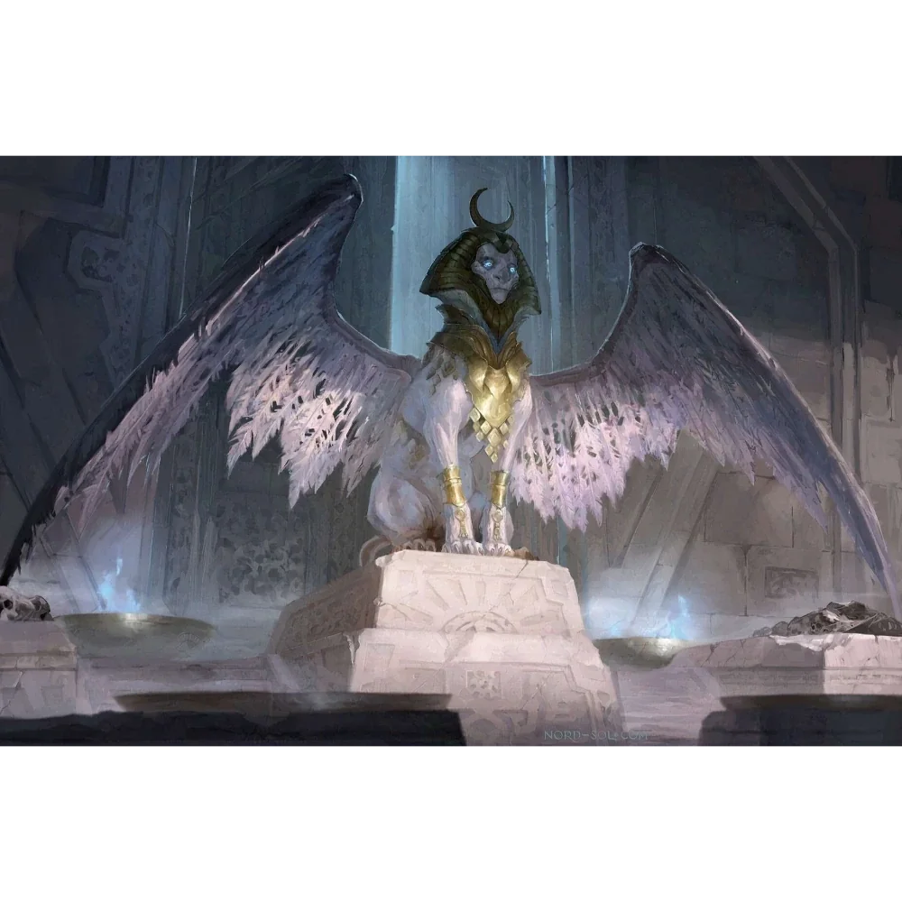

_Oskarżony Androsfinks_

## Opis
Androsfinks o ptasich rysach z [[Wyspa Czasu|Wyspy Czasu]]. Został uznany za niewinnego i uwolniony.

## Osobowość
Dumny, ale przerażony perspektywą sądu.

## Historia
W [[Sesja 58 - Wyspa Czasu]] sądzono go, spętanego magicznymi więzami, za rzekome oszustwo w grze słownej (użycie słowa „Wiedźmin”). Jedyny dowód jego niewinności, [[Wielka Księga Zasad]], zniknął, więc jego los miało rozstrzygnąć głosowanie o niemal pewnym wyniku. Oskarżał go [[Noland]]; [[Waywa]] wyznała bohaterom miłość do niego i strach o jego los.

W [[Sesja 59 - Koniec Imprezy]] [[Bilatro]] znalazła w odnalezionej [[Wielka Księga Zasad|Księdze]] słowo „Wiedźmin” i Kartos został uznany za niewinnego, a [[Kabira Nasir|mechaniczny anioł]] go uwolnił. Gdy Waywa zapytała Nolanda, czy naprawdę zrobiłby coś takiego Kartosowi, którego kocha, Kartos odparł, że on kocha wiedźmina. Wraz z Waywą i [[Kallisti]] zagłosował za przeprosinami dla [[Wiedźma Lotosu|Wiedźmy Lotosu]].
