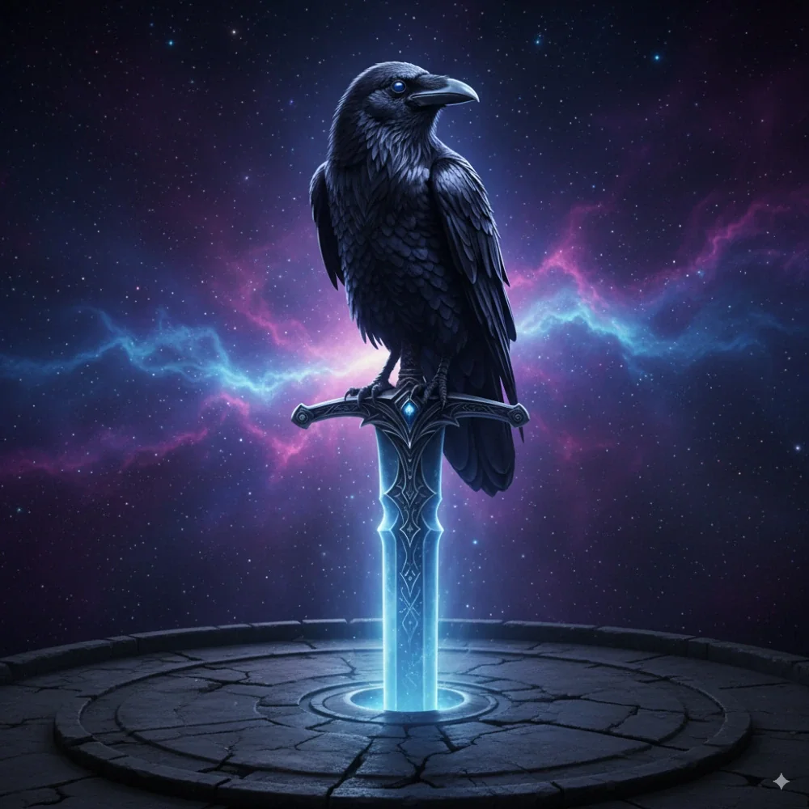

_Kruk Kolekcjoner_

## Opis
Kruk potrafiący mówić, siedzący na czubku miecza w Skarbcu na [[Wyspa Czasu|Wyspie Czasu]]. Kolekcjoner unikatowych przedmiotów.

## Osobowość
Kruk, ekscentryczny kolekcjoner i handlarz.

## Historia
W [[Sesja 58 - Wyspa Czasu]] handlował z bohaterami: [[Orestes]] wymienił u niego kieł dzika, który kiedyś go zabił, na księgę o piwie, a [[Felicjan Janus Twardowski|Felicjan]] pistolet Glock 17 na wojenny róg. Zaintrygowany ich determinacją, udzielił im kluczowej wskazówki: by zajrzeć w przeszłość i przyszłość, muszą podążyć ścieżką na wschód.
