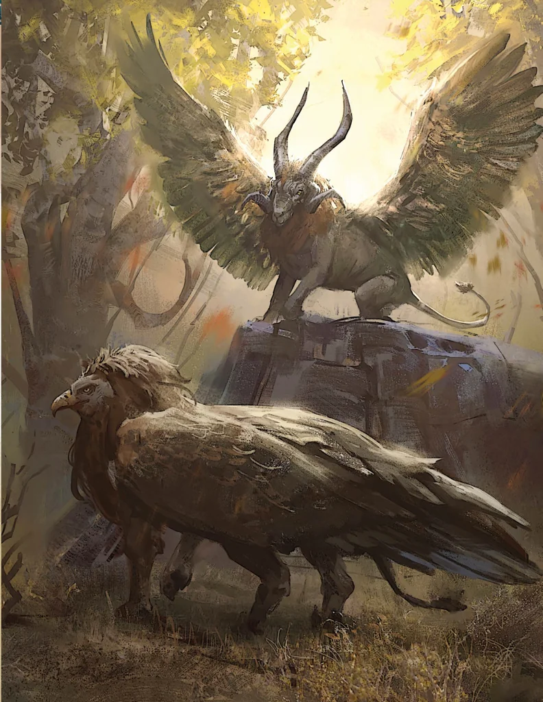

_Kriosfinks, Zdrajca_

## Opis
Srogi kriosfinks o baraniej głowie z [[Wyspa Czasu|Wyspy Czasu]]. Zdemaskowany jako zdrajca, został pochwycony przez [[Kabira Nasir|mechanicznego anioła]].

## Osobowość
Nieugięty, przekonany o konieczności obrony zasad. Okazał się zazdrosnym manipulatorem, który kocha [[Waywa|Waywę]].

## Historia
W [[Sesja 58 - Wyspa Czasu]] był oskarżycielem w procesie [[Kartos|Kartosa]]: zarzucił mu oszustwo i tchórzliwe ukrycie [[Wielka Księga Zasad|Wielkiej Księgi Zasad]], twierdząc, że chodzi o zasadę, a nie o jedno słowo.

W [[Sesja 59 - Koniec Imprezy]] zniknął z komnaty gier; [[Bilatro]] powiedziała, że poszedł się przewietrzyć. Bohaterowie zastali go w ruinach z zaginioną Księgą, którą zamierzał spalić, by wrobić rywala. Przywołał trzy latające stwory podobne do mózgów z mackami (Grelle) i stworzył swój temporalny duplikat, lecz został pokonany. Oskarżył bohaterów o kradzież księgi i próbę morderstwa, jednak jego kłamstwa nie wytrzymały konfrontacji. Na sądzie, zapytany przez Waywę, czy naprawdę zrobiłby coś takiego Kartosowi, odparł zrezygnowany, że kocha ją. Mechaniczny anioł pochwycił go po uwolnieniu Kartosa.
