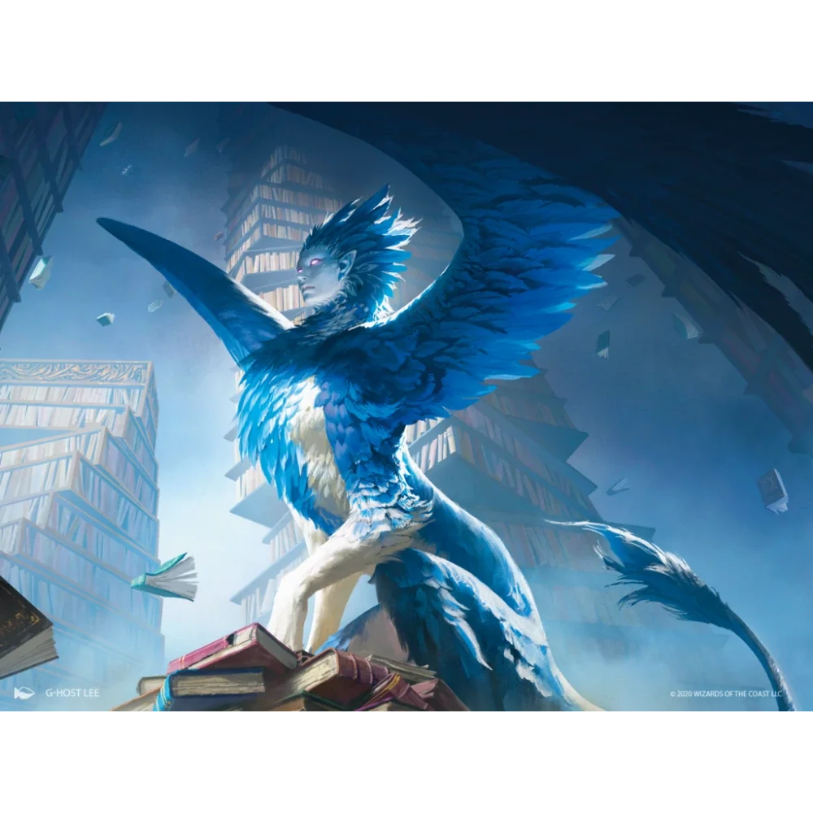

_Zakochana Gynosphinx_

## Opis
Gynosphinx o stoickiej masce, która ledwo skrywała głęboki ból.

## Osobowość
Zakochana w [[Kartos|Kartosie]].

## Historia
W [[Sesja 58 - Wyspa Czasu]] odciągnęła bohaterów na bok i szeptem wyznała swą miłość do [[Kartos|Kartosa]] oraz strach o jego los.

W [[Sesja 59 - Koniec Imprezy]] zapytała [[Noland|Nolanda]], czy naprawdę zrobiłby coś takiego Kartosowi, którego kocha. Wraz z Kartosem i [[Kallisti]] zagłosowała za przeprosinami dla [[Wiedźma Lotosu|Wiedźmy Lotosu]].
