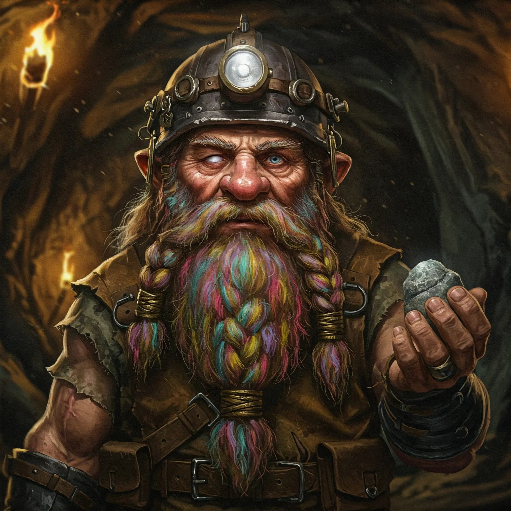

_Krasnolud z plemienia Wieloryba, widzący na jedno oko, mówiący zagadkami._

## Opis
Borinn to krasnolud z jednym ślepym okiem, noszący górniczy kask ze śladami uderzenia.

## Osobowość
Mówi zagadkami i nerwowo obawia się smoczycy [[Ventis]]. Ma obsesję na punkcie swojego zgubionego kilofa i opowiada o potędze żelaza oraz potrzebie szacunku do niego.

## Historia
W [[Sesja 43 - Kopalnia Żelaza]] ukrywał się za kamieniem przed [[Ventis]], która zajęła [[Kopalnia Żelaza|Kopalnię Żelaza]], i ostrzegł bohaterów, że smoczyca będzie niezadowolona. Opowiedział im o tragedii [[Plemię Wieloryba|plemienia Wieloryba]] i wspomniał o swojej zgubie, kilofie. Poprowadził ich do obozu plemienia (gdzie jeden z krasnoludów oskarżył go z gniewem o przyprowadzenie obcych), a na prośbę bohaterów naszkicował poglądowy rysunek leża smoka, wskazując zagrożenia. Następnie poprowadził drużynę do wejścia do kopalni.
