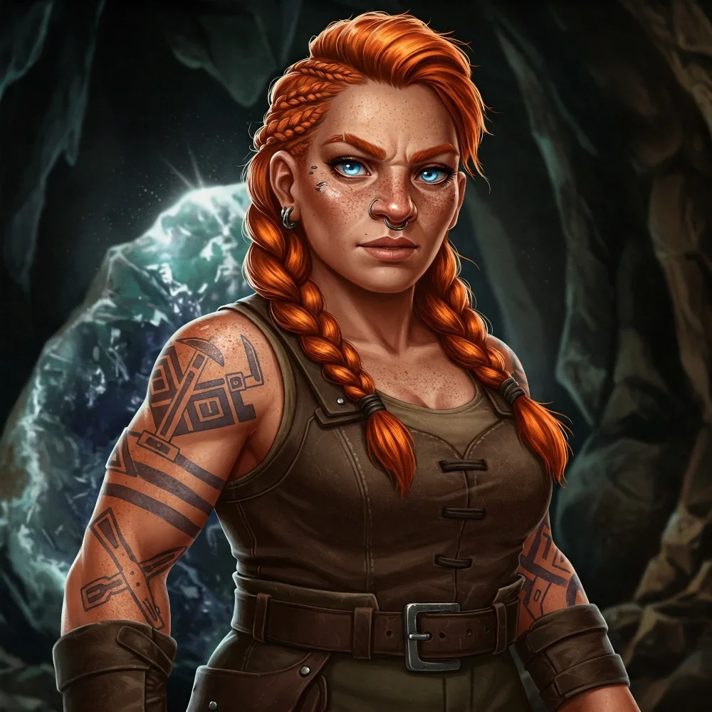

_Córka wodza plemienia Wieloryba, Delga._

## Opis
Młoda krasnoludka.

Córka [[Delg|Delga]], wodza [[Plemię Wieloryba|plemienia Wieloryba]]. Mimo niewoli zachowała odwagę.

## Historia
W [[Sesja 43 - Kopalnia Żelaza]] okazało się, że smoczyca [[Ventis]], która zajęła [[Kopalnia Żelaza|Kopalnię Żelaza]], porwała ją i trzyma jako zakładniczkę w swoim leżu, w naturalnej jaskini połączonej z tunelami kopalni. Dzięki temu zmusiła Delga i całe plemię do posłuszeństwa.

W [[Sesja 44 - Ventis]] kpiła z Ventis i kwestionowała jej przekonania. Gdy bohaterowie ruszyli na pomoc, [[Versir]] teleportował ją w objęcia [[Felicjan Janus Twardowski|Felicjana]], który zaklęciem Dimension Door przeniósł ją na szczyt góry, z dala od pola walki. Jej uratowanie pozwoliło bohaterom skupić się na walce z Ventis, a plemię Wieloryba zawarło z nimi sojusz.

## Po wojnie
[[Felicjan Janus Twardowski|Felicjan]] chciałby, żeby została pierwszą adeptką [[Smoczy Lordowie|Zakonu Smoczych Lordów]] z [[Wyspa Indygo|Indygo]], a z czasem może szefową tamtejszej filii. Byłaby najlepszą odpowiedzią na nieufność wyspy wobec starego Zakonu, w którego imię terroryzowała ją [[Ventis]]: Smoczy Lordowie nie przychodziliby już na Indygo z zewnątrz, bo jedna z nich stamtąd pochodzi. Córka strażników jedynej kopalni żelaza w Zakonie to jednak też powód, by posądzać Zakon, że trzyma rękę na żelazie.
