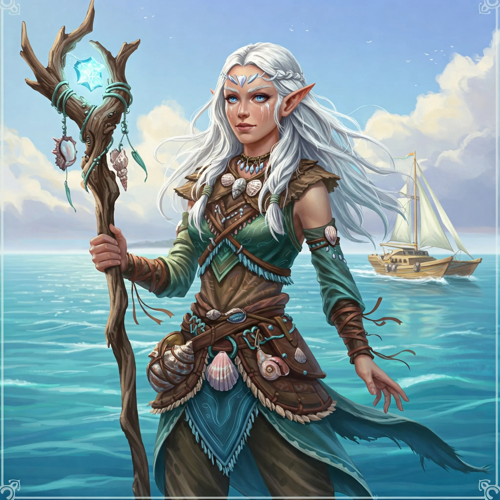

_Dostojna elfka, otoczona szacunkiem swych pobratymców, przywódczyni Plemienia Delfina._

## Opis
Delfin jest dostojną elfką, przywódczynią [[Plemię Delfina|Plemienia Delfina]], otoczoną szacunkiem swych pobratymców. Przyjmuje gości z godnością i powagą.

## Osobowość
Jest nieufna wobec obcych, ale potrafi słuchać i doceniać dyplomację. Zależy jej na dobru swojego ludu i całej wyspy.

## Historia
Jej plemię, jak wyjaśniła bohaterom [[Astra]], preferowało kontakty z własnym ludem ([[Sesja 42 - Plemię Węgorza]]).

W [[Sesja 43 - Kopalnia Żelaza]] przyjęła delegację bohaterów, z których [[Arevon Elorrenthi|Arevon]] przemawiał w roli rzecznika. Wysłuchawszy ich, podzieliła się wiedzą o smoczycy [[Ventis]], która siała postrach na wyspie, powołując się na chwałę [[Smoczy Lordowie|Smoczych Lordów]], oraz o zniszczeniach w osadzie elfów i milczeniu [[Plemię Wieloryba|plemienia Wieloryba]]. Wskazała, że smoczyca najpewniej kieruje się na wschód, ku plemieniu Wieloryba. Po wizycie bohaterowie wysłali do niej list przez chowańca.

W [[Sesja 44 - Ventis]], po pokonaniu Ventis, elfowie z jej plemienia byli wdzięczni i zadeklarowali swoją pomoc.

W [[Sesja 85 - Cienie nad Arezją]] przy ogniskach plemienia poczęstowała [[Arevon Elorrenthi|Arevona]] winem i zapytała, czy nie kusi go powrót do ojczystego świata.
