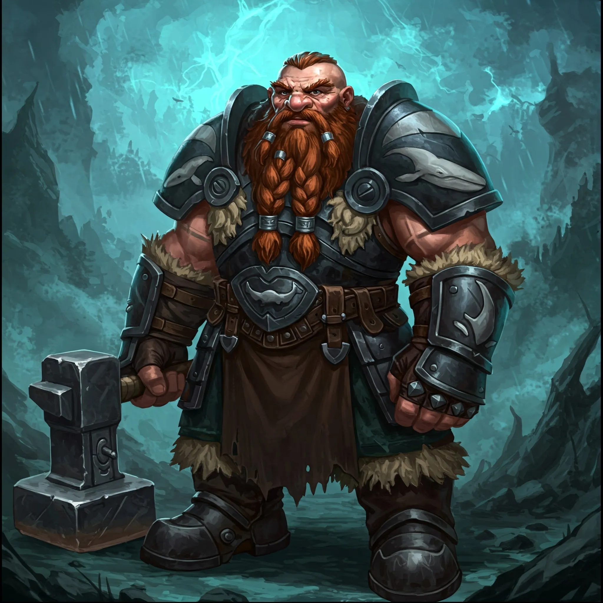

_Zdesperowany przywódca krasnoludów z plemienia Wieloryba._

## Opis
Potężny krasnolud, którego twarz nosi ślady troski i bezsilności.

Przywódca [[Plemię Wieloryba|plemienia Wieloryba]] i ojciec [[Brenna|Brenny]].

## Osobowość
Odpowiedzialny przywódca, którego porwanie córki pozbawiło siły do oporu: wobec smoka wyrażał bezsilność i troskę o jej los.

## Historia
Gdy [[Ventis]] zajęła [[Kopalnia Żelaza|Kopalnię Żelaza]], Delg został zmuszony do posłuszeństwa, ponieważ smoczyca porwała jego córkę.

W [[Sesja 43 - Kopalnia Żelaza]] z rezygnacją słuchał bohaterów; dopiero wzmianka o bliskim starciu ze smoczycą wzbudziła w nim iskrę nadziei. Opowiedział im o [[Brenna|Brennie]], trzymanej jako zakładniczka w leżu smoka.

W [[Sesja 44 - Ventis]] bohaterowie uratowali jego córkę i pokonali Ventis, a część złota z jej leża przekazali plemieniu Wieloryba, z którym zawarli sojusz.

W [[Sesja 85 - Cienie nad Arezją]] wraz ze starszyzną wysłuchał na plaży wysłanników Neurdagonów, którzy wyłożyli skrzynię srebra za pięcioletnią wyłączność na urobek z góry, i kupców z [[Arezja|Arezji]], którzy oferowali wyższą sumę w ratach. Odrzucił wyłączność i utrzymał podział urobku między oba miasta.
