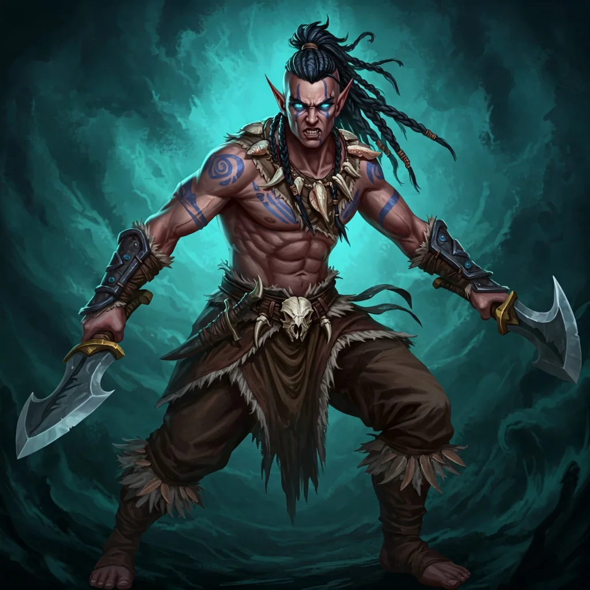

_Arogancki przywódca Plemienia Rekina._

## Opis
Niezwykle wysoki i szczupły półelf, groźny wojownik.

Przywódca [[Plemię Rekina|Plemienia Rekina]], który objął wodzostwo po poprzednim przywódcy, zabitym smoczym kwasem ([[Sesja 42 - Plemię Węgorza]]).

## Osobowość
Arogancki i niechętny do współpracy. Pewny siebie i gardzący słabością.

## Historia
W [[Sesja 44 - Ventis]], po pokonaniu smoczycy [[Ventis]], rozmowy z nim nie poszły pomyślnie: okazał się arogancki i niechętny do współpracy, więc sojuszu z jego plemieniem nie zawarto. Urażony brakiem wdzięczności [[Orestes]] wyzwał go na honorowy pojedynek i przegrał. Zanim Gorac zadał ostateczny cios, [[Arevon Elorrenthi|Arevon]] uleczył Orestesa; Gorac wzgardził tym ruchem, ale pozwolił drużynie odejść bez dalszego rozlewu krwi.
