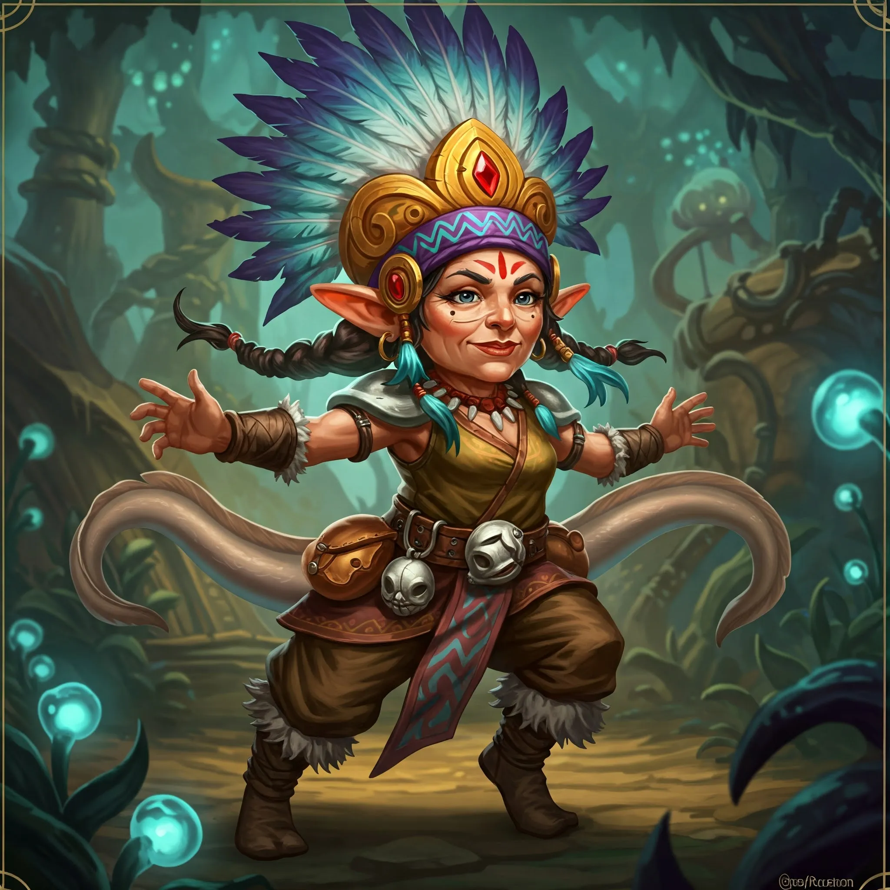

_Gnomka o żywym spojrzeniu i barwnym stroju, przywódczyni Plemienia Węgorza._

## Opis
Loopywoopy jest gnomką o żywym spojrzeniu. Ubiera się w barwne stroje, na głowie nosi misterne nakrycie, a do pasa ma przyczepione wypchane ogony węgorzy, świadectwo jej pozycji i charakterystyczny element stroju plemienia.

## Osobowość
Jest kobietą mądrą i przedsiębiorczą, serdeczną i gościnną. Chętnie dzieli się wiedzą o wyspie i jej mieszkańcach.

## Historia
Jest przywódczynią [[Plemię Węgorza|Plemienia Węgorza]], którego członkowie, według [[Astra|Astry]], są przyjaźni.

W [[Sesja 42 - Plemię Węgorza]] przyjęła bohaterów w osadzie, wyprawiła ucztę na ich cześć i opowiedziała o miedzianej smoczycy [[Ventis]], która siała postrach na wyspie, powołując się na chwałę [[Smoczy Lordowie|Smoczych Lordów]]. Wyjaśniła też, że plemię Wieloryba od kilku tygodni milczy, a poprzedni przywódca plemienia Rekina zginął stopiony smoczym kwasem. Pod koniec uczty Ventis zaatakowała osadę.

W [[Sesja 44 - Ventis]] świętowała z bohaterami po zwycięstwie: plemię Węgorza przyjęło ich z entuzjazmem i zawarło sojusz, a Orestes siłował się na rękę z jej przywódczynią.
