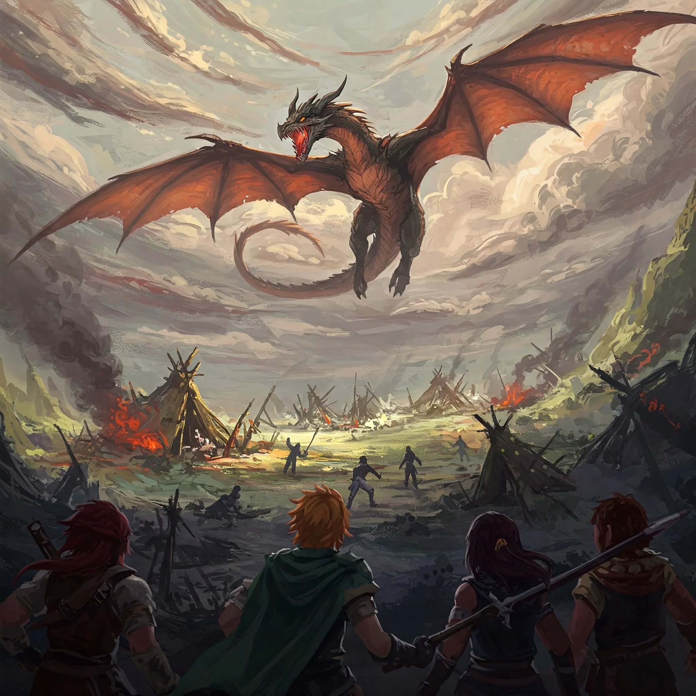

_Potężna miedziana smoczyca służąca Sydonowi._

## Opis
Miedziany smok "hodowlany" [[Sydon|Sydona]].

Miedziana smoczyca, która lata, zieje kwasem i ma potężne pazury. Zginęła w [[Sesja 44 - Ventis]], a w [[Sesja 69 - Ogród Lutherii]] powróciła jeszcze raz na arenie i została pokonana ponownie.

## Osobowość
Działa jako niszczycielka.

Okrutna: zabija kwasem i sieje postrach, powołując się na chwałę [[Smoczy Lordowie|Smoczych Lordów]]. Pałająca żądzą władzy i przekonana o swojej wyjątkowości, chełpiła się obietnicami [[Sydon|Sydona]], który obiecał jej panowanie nad wyspą.

## Historia
Została wysłana na [[Wyspa Indygo]], aby sprowokować wewnętrzne walki między plemionami barbarzyńców i wyeliminować ich jako potencjalne zagrożenie dla planów Tytanów.

W [[Sesja 42 - Plemię Węgorza]] zaatakowała osadę [[Plemię Węgorza|Węgorzy]], gdzie starła się z bohaterami. Mimo unieruchomienia magicznymi pnączami przez druida [[Arevon Elorrenthi|Arevona]] i ciosów [[Orestes|Orestesa]], którego [[Versir]] teleportował na jej grzbiet, zdołała legendarną akcją zrzucić minotaura skrzydłami i uciec z pola walki. Wcześniej stopiła kwasem poprzedniego przywódcę plemienia Rekina.

W [[Sesja 43 - Kopalnia Żelaza]] okazało się, że zajęła [[Kopalnia Żelaza|Kopalnię Żelaza]], jedyne źródło żelaza w Thylei, a jej leże znajduje się w naturalnej jaskini połączonej z tunelami kopalni. Zmusiła [[Plemię Wieloryba]] do posłuszeństwa, porywając córkę ich wodza [[Delg|Delga]], [[Brenna|Brennę]], i trzymając ją jako zakładniczkę. Sprzymierzyła się z dzikimi zwierzętami; kopalni strzegły wodne bestie, wodne żywiołaki i żywe pioruny.

W [[Sesja 44 - Ventis]] została pokonana i zabita w swoim leżu przez [[Bohaterowie Przepowiedni|Bohaterów Przepowiedni]]. [[Arevon Elorrenthi|Arevon]] zużył na nią wszystkie trzy legendarne odporności smoka, Orestes powalił ją magicznym toporem, a ostatni cios Lightning Bolt zadał jej Versir. Jej śmierć zakończyła terror na Wyspie Indygo. Bohaterowie pozyskali z jej ciała i leża krew, zęby, kości, rogi, łuski i skrzydła, mogące posłużyć do stworzenia magicznych przedmiotów.

W [[Sesja 69 - Ogród Lutherii]] wśród dawnych wrogów, którzy powrócili na arenę [[Wyspa Krzywoprzysięstwa|Wyspy Krzywoprzysięstwa]], dosiadał jej [[Piekielny Dyrygent]]. Zionęła spowalniającym gazem i została ponownie pokonana przez Bohaterów Przepowiedni, tym razem przebita włócznią przez [[Orion Xul|Oriona]].
