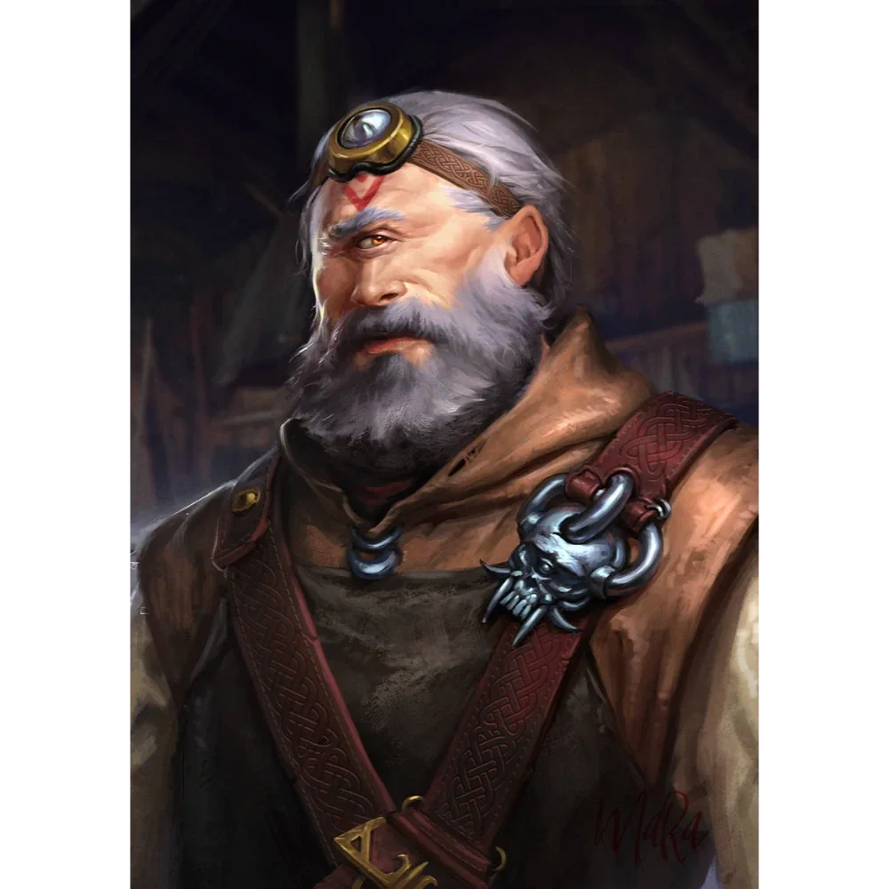

_Jancan, syn Bronta, kowal z Wyspy Ognia i dowódca Egidy Mytros, poległ w Bitwie o Mytros._

## Opis
Steros był cyklopem jancanem, synem [[Bront|Bronta]]. Zginął w pierwszej fali [[Sesja 76 - Bitwa o Mytros: Pierwsza Fala|Bitwy o Mytros]]; według [[Sesja 84 - Świt Nowej Ery]] był lepszym rzemieślnikiem od ojca.

Jancan to rzadki rodzaj cyklopa z dziesięcioma palcami u rąk i nóg, co czyni go naturalnym kowalem i artyficerem. Był mniejszy od typowych cyklopów. Wychował się w wieży [[Praxys]], gdzie był obiektem drwin. Nosił specjalny monokl, który korygował jego wzrok i dawał magiczne zdolności. Potrafił tworzyć mechaniczne zwierzęta.

## Osobowość
Inteligentniejszy od typowego cyklopa, dumny ze swoich umiejętności kowalskich.

## Historia
Został wysłany przez [[Sydon|Sydona]] na [[Wyspa Ognia|Wyspę Ognia]], by zastąpić swojego ojca, [[Bront|Bronta]], który został porwany.

W [[Sesja 37 - Próba Ognia]] bohaterowie dowiedzieli się, że Sydon dostarczył Chodzącym w Ogniu nowego kowala. Był nim Steros, który zajął miejsce ojca; Bront, uwolniony przez bohaterów, dowiedział się o losie syna i był wściekły, że jest zmuszony pracować w takim miejscu.

W [[Sesja 38 - Bitwa w Kalderze]] po bitwie wrócił z drużyną i Brontem do wioski jaszczuroludzi.

W [[Sesja 76 - Bitwa o Mytros: Pierwsza Fala]] jako dowódca [[Egida Mytros|Egidy Mytros]] walczył z automatonami Sydona w pierwszej rundzie Bitwy o [[Mytros]] i poległ, zadając drużynie cios prosto w serce. Po jego śmierci dowództwo nad [[Egida Mytros|Egidą]] objęła [[Corinna]]; w [[Sesja 77 - Bitwa o Mytros: Upadek Icarusa]] stanęła na czele jednego z legionów.

W [[Sesja 84 - Świt Nowej Ery]] podsumowano powojenne losy [[Mithralowa Kuźnia|kuźni]]: obowiązki [[Volkan|Volkana]] przy kowadle przejął Bront i okazał się kowalem na tyle dobrym, że godnie zastąpił boga. Steros, lepszy rzemieślnik od ojca, tego czasu nie doczekał.

## Śmierć
Steros poległ w **pierwszej rundzie Bitwy o [[Mytros]]**, w starciu legionu [[Egida Mytros|Egidy Mytros]] z automatonami [[Sydon|Sydona]].

Był to pierwszy dowódca stracony przez obrońców i pierwszy prawdziwy cios tej wojny — jancan, który całe życie budował mechaniczne zwierzęta, zginął rozbity przez cudze konstrukty.

Dowództwo nad [[Egida Mytros|Egidą]] objęła po nim **[[Corinna]]** — cywilka, którą bohaterowie uratowali na początku swojej drogi.

