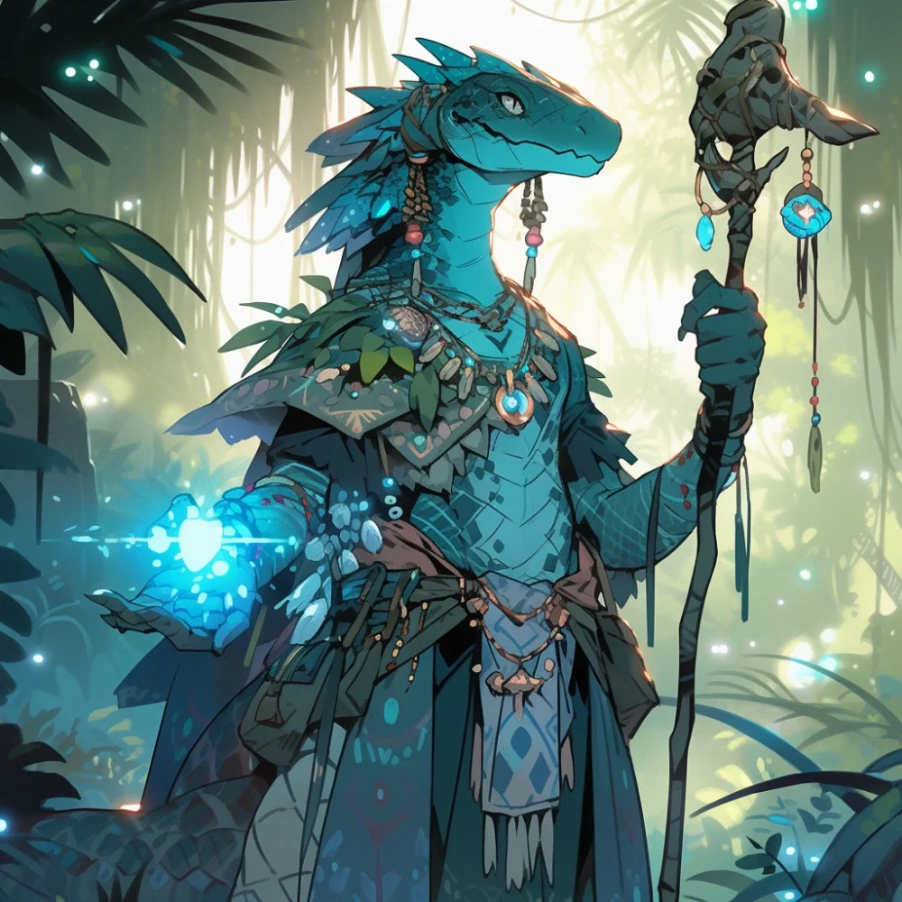

_Królowa plemienia Łamaczy Fal na Wyspie Ognia._

## Opis
Królowa jaszczuroludzi z plemienia Łamaczy Fal, które sprzeciwiało się Chodzącym w Ogniu.

Dumna i honorowa, choć jej standardy mogą wydawać się brutalne dla innych ras (np. ofiarowanie syna na ucztę).

## Osobowość
Nienawidzi [[Jankor|Jankora]] za to, że odwrócił się od dawnych tradycji i oddał część smoczych jaj [[Sydon|Sydonowi]]. Wierzy w Śpiącego Boga w wulkanie.

## Historia
Vytha włada plemieniem Łamaczy Fal, które sprzeciwia się Jankorowi, wspieranemu przez [[Sydon|Sydona]].

W [[Sesja 37 - Próba Ognia]] bohaterowie wraz z uwolnionym [[Bront|Brontem]] spotkali ją wśród ukrywających się jaszczuroludzi. Wyjaśniła, że jej plemię sprzeciwia się Chodzącym w Ogniu, bo król Jankor porzucił dawne tradycje, pluje na smoki i Śpiącego Boga w wulkanie; bohaterowie dowiedzieli się od niej też, że Sydon dostarczył Chodzącym w Ogniu nowego kowala.

W [[Sesja 38 - Bitwa w Kalderze]] po zwycięstwie nad Jankorem i jego ludźmi spotkała się z bohaterami w wiosce jaszczuroludzi, wyraziła wdzięczność i zaoferowała ucztę.
