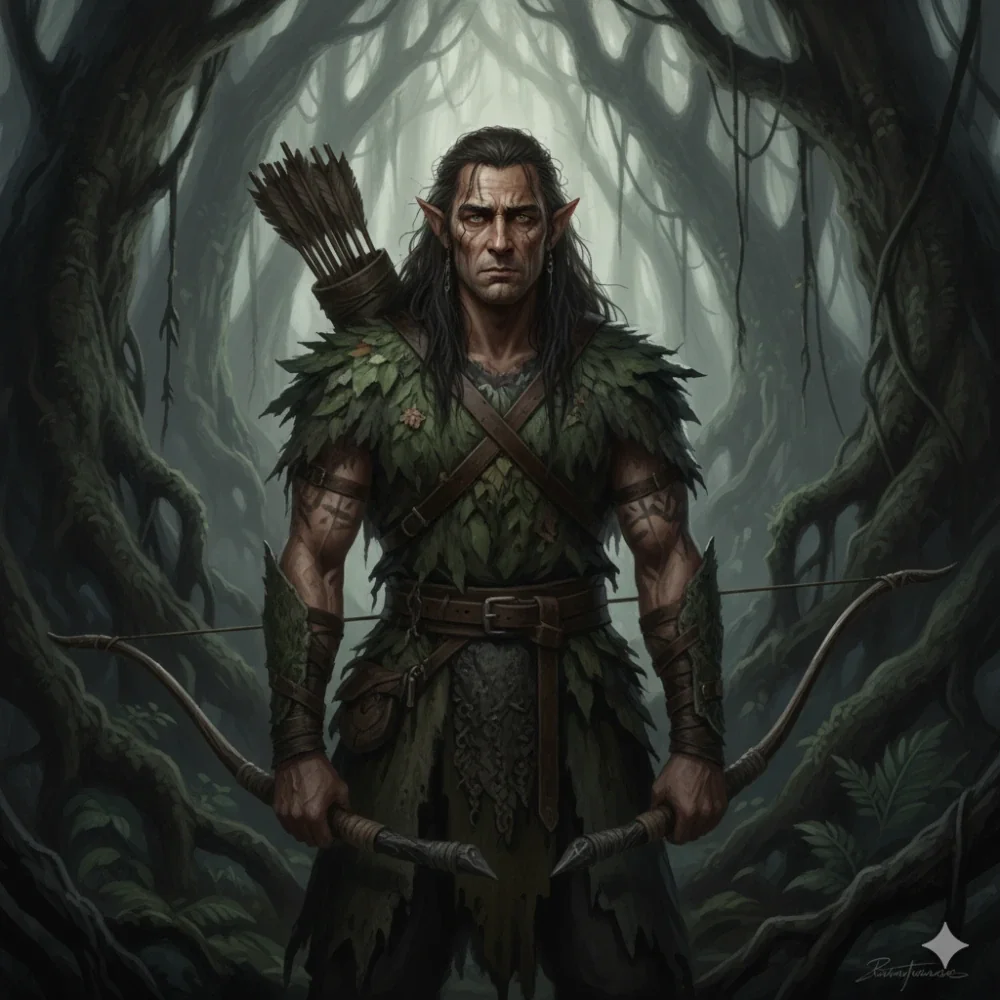

_Przywódca elfiego ruchu oporu na Wyspie Smoka, mnich-wojownik._

## Opis
Przywódca elfiego ruchu oporu na [[Wyspa Smoka|Wyspie Smoka]], dowodzący nim wspólnie z [[Patrea|Patreą]]. Podejrzliwy wobec obcych.

Elficki mnich-wojownik, zaprawiony w bojach i życiu w ciągłym zagrożeniu. Jego ciało zdobią blizny, a ubiór dostosowany jest do walki w dżungli.

## Osobowość
Poważny, odpowiedzialny, oddany przetrwaniu swojego ludu. Nienawidzi [[Hexia|Hexii]] za terror, jaki sieje wśród elfów.

## Historia
Darok, wraz z Patreą, dowodził grupą elfów ukrywających się przed [[Hexia|Hexią]] na Wyspie Smoka. Przez lata żyli w ciągłym strachu, będąc zwierzyną łowną dla smoczycy.

W [[Sesja 64 - Pieśń dla Smoczycy]], jak wcześniej opowiedziała bohaterom [[Moxena]], na wyspie obok fanatycznych druidów z Kręgu Łuski żyli nieliczni, dzicy buntownicy z ruchu oporu. Darok i Patrea zastąpili drużynie drogę w dżungli, napinając łuki, lecz nie atakując; Darok zauważył, że bohaterowie chodzą po lesie, „jakby ziemia pod waszymi stopami należała do was”. Gdy usłyszeli cel wyprawy, napięcie opadło; ostrzegli bohaterów przed [[Kraken|Krakenem]], którego ofiary wyrzucało na brzeg po sztormach, i wskazali drogę do leża Hexii, lecz sami odmówili udziału w tej samobójczej, ich zdaniem, misji. W drodze powrotnej bohaterowie odszukali Daroka i jego grupę, powiedzieli im o wyniku misji i zaproponowali ucieczkę z wyspy. Piętnastu elfich wojowników przyjęło propozycję dołączenia do załogi [[Ultros|Ultrosa]].
