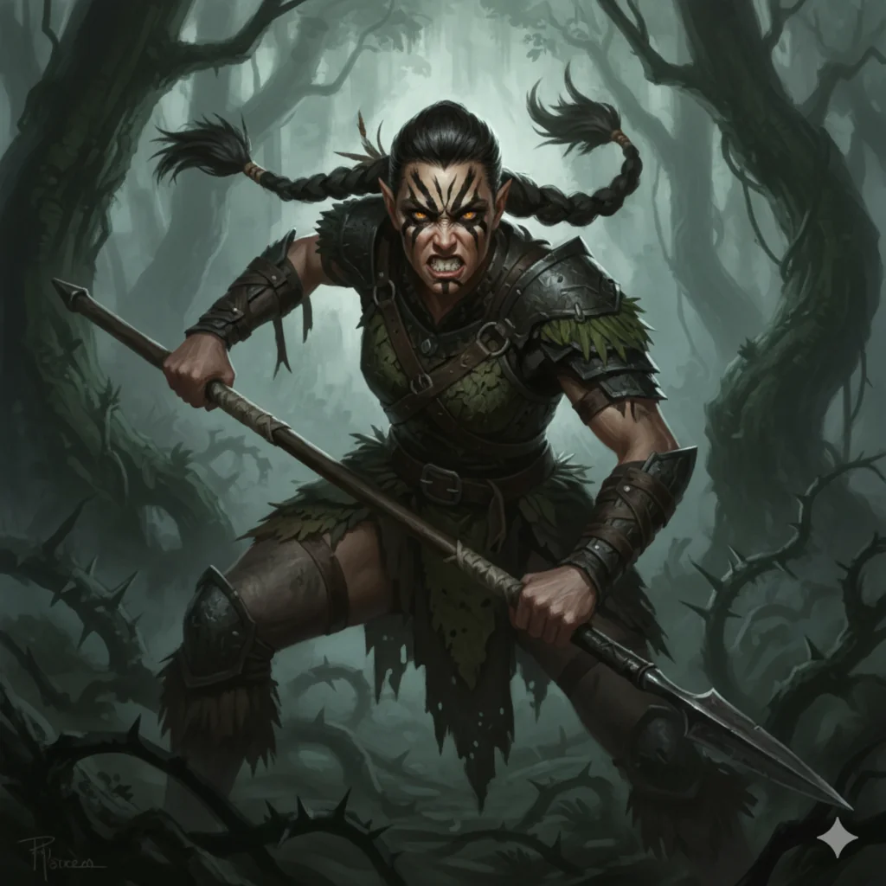

_Przywódczyni elfiego ruchu oporu na Wyspie Smoka._

## Opis
Elfka z ruchu oporu na [[Wyspa Smoka|Wyspie Smoka]], która wraz z [[Darok|Darokiem]] przewodziła buntownikom.

Dumna i dzika wojowniczka. Jest bezwzględna w walce i gotowa na wszystko, by chronić swoich ludzi.

## Osobowość
Odważna i podejrzliwa wobec obcych; odmówiła udziału w uznanej za samobójczą misji przeciw [[Hexia|Hexii]].

## Historia
Współdowodziła elfim ruchem oporu na Wyspie Smoka wraz z Darokiem.

W [[Sesja 64 - Pieśń dla Smoczycy]] razem z Darokiem zastąpiła drużynie drogę w dżungli, podejrzliwa wobec obcych. Gdy poznali cel wyprawy, ostrzegli bohaterów przed [[Kraken|Krakenem]] i wskazali drogę do leża [[Hexia|Hexii]], lecz odmówili udziału w tej misji. Później bohaterowie zaproponowali elfom ucieczkę z wyspy i piętnastu elfich wojowników z ruchu oporu dołączyło do załogi [[Ultros|Ultrosa]].

Patrea zdecydowała się opuścić wyspę na pokładzie Ultrosa wraz z pozostałymi ocalałymi wojownikami.
