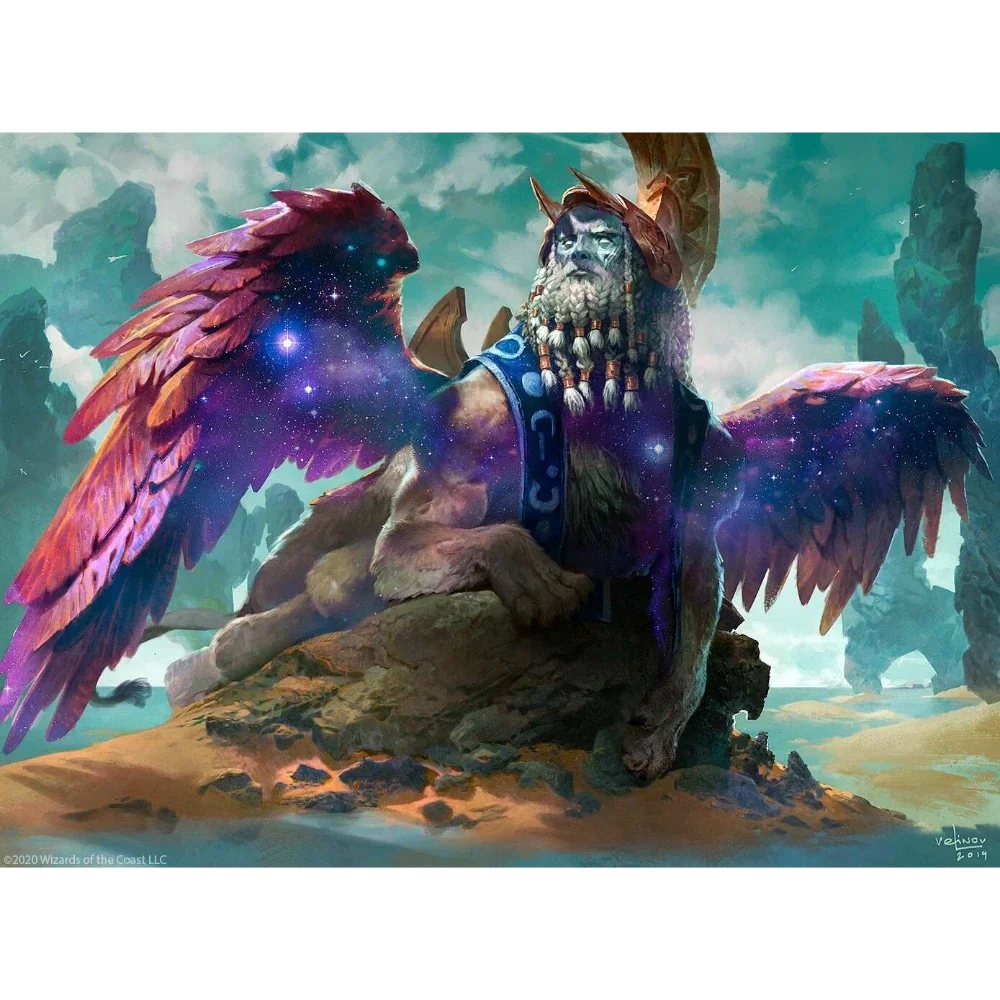

_Zmarły, poprzedni król Wyspy Wygnańców, brutalny tyran._

## Opis
Poprzedni król [[Wyspa Wygnańców|Wyspy Wygnańców]], brutalny i bezwzględny. Rządził strachem i przemocą. Został zamordowany jako pierwsza ofiara rytualnego mordercy i pochowany na cmentarzu wyspy.

## Osobowość
Okrutny, despotyczny; [[Keelan]] wspominał go z pogardą jako tyrana.

## Historia
W [[Sesja 45 - Tajemnica Wyspy Wygnańców]] [[Stavros]] opowiedział bohaterom o serii morderstw: Cronos był pierwszą ofiarą, przed [[Lysander|Lysanderem]], [[Petros|Petrosem]] i [[Marius|Mariusem]]. Jego grób na cmentarzu zawierał sakiewkę z trzema małymi palcami, obciętymi ofiarom przez mordercę.

W [[Sesja 46 - Morderca z Wyspy Wygnańców]] bohaterowie obserwowali jego grób, bo morderca miał dopełnić rytuału, składając w nim kolejny palec; nie pojawił się. Mordercą okazał się Keelan, który nazwał Cronosa tyranem i twierdził, że próbował oczyścić wyspę z jej brudów.
