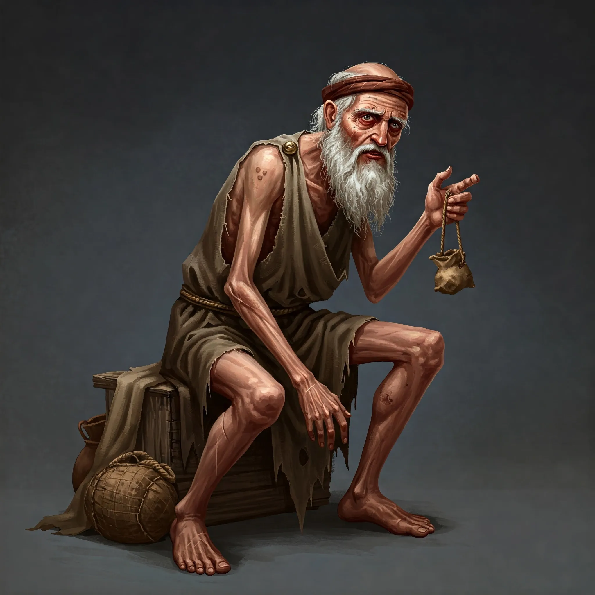

_Niedowidzący starzec z Wyspy Wygnańców, świadek dziwnych zdarzeń na cmentarzu._

## Opis
Niedowidzący starzec, wygnaniec na [[Wyspa Wygnańców|Wyspie Wygnańców]], noszący imię Elara.

## Historia
W [[Sesja 45 - Tajemnica Wyspy Wygnańców]] bohaterowie spotkali go i wspomniał im o wzmożonym nocnym ruchu na cmentarzu, gdzie wkrótce znaleźli grób [[Cronos|Cronosa]] z sakiewką pełną palców.

W [[Sesja 46 - Morderca z Wyspy Wygnańców]] został przyprowadzony przed drzewo figowe, które natychmiast „rozpoznało”, że to nie on zrywał liście. Mordercą okazał się [[Keelan]].
