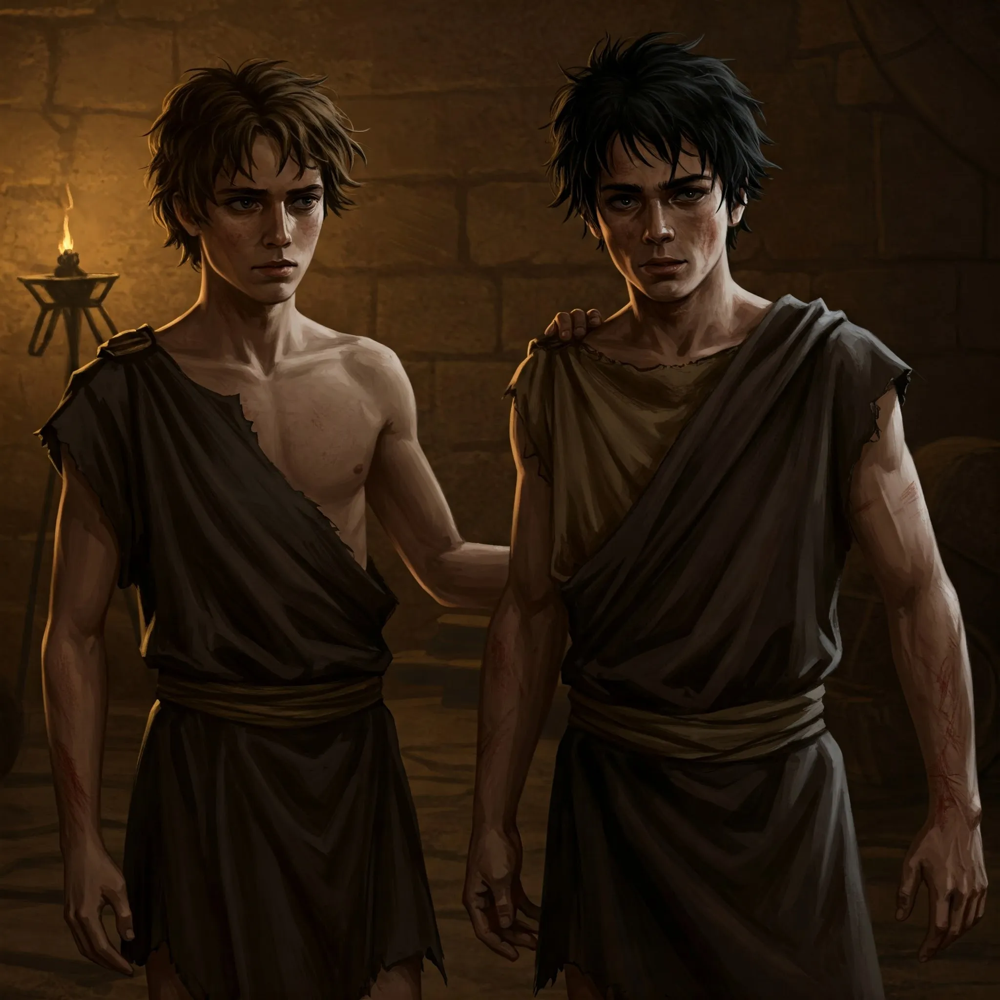

_Człowiek Tyrone'a, wygnaniec z Wyspy Wygnańców._

## Opis
Wygnaniec na [[Wyspa Wygnańców|Wyspie Wygnańców]], człowiek [[Tyrone|Tyrone'a]], zesłany za włamanie na zlecenie, które poszło nie tak. Towarzyszy mu [[Silas]].

## Osobowość
Znużony i zirytowany, ale też lekko smutny; boi się mordercy i ma nadzieję, że Tyrone ich obroni.

## Historia
W [[Sesja 45 - Tajemnica Wyspy Wygnańców]] pojawił się wśród wygnańców.

W [[Sesja 46 - Morderca z Wyspy Wygnańców]] bohaterowie zastali go z Silasem przy przenoszeniu beczek z wina w pobliżu chaty ich mocodawcy. Pod presją [[Orestes|Orestesa]] przyznał, że zesłano ich za włamanie, a o [[Marius|Mariusie]] mówił ciepło, wspominając wspólne picie wina za plecami Tyrone'a. [[Felicjan Janus Twardowski|Felicjan]] wyczuł w jego głębszych myślach strach przed mordercą. Nie był zamieszany w zbrodnie, a jego buty nie pasowały do znalezionego odcisku.
