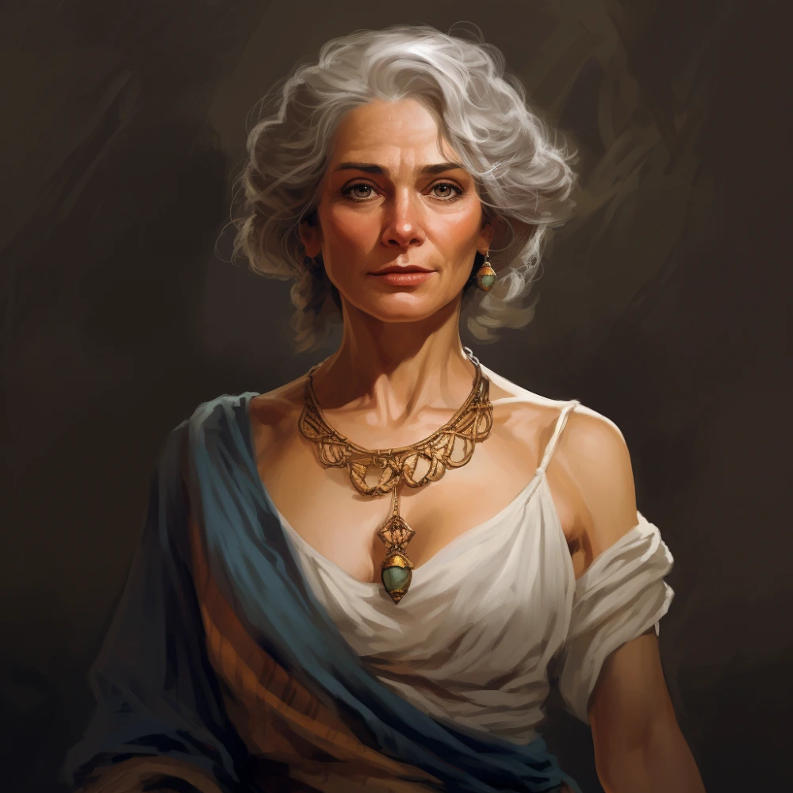

_Matka Króla Acastusa, wygnana na wyspę._

## Opis
Matka [[Acastus|Acastusa]], króla [[Mytros]]. Siwowłosa kobieta; wspomina o swoim pochodzeniu z nieukrywaną dumą. Po wydarzeniach z [[Sesja 46 - Morderca z Wyspy Wygnańców]] wróciła do Mytros i mieszka w pałacu, we własnych prywatnych komnatach.

Bardzo piękna kobieta w średnim wieku, zadbana mimo trudnych warunków. Nosi się z godnością.<!-- UNSOURCED -->

## Osobowość
Manipulantka, politycznie uzdolniona. Dba o pozory, ale bez mrugnięcia okiem poświęciłaby sojusze dla własnej korzyści.<!-- UNSOURCED -->

## Historia
Na wyspie rywalizowała o wpływy, choć oficjalnie zachowywała dystans.<!-- UNSOURCED -->

Została wygnana na [[Wyspa Wygnańców|Wyspę Wygnańców]] z powodu plotek o jej zbyt dużym wpływie na syna, Acastusa.

W [[Sesja 45 - Tajemnica Wyspy Wygnańców]] powitała bohaterów samotnie na kamiennym doku, przedstawiła się i z dumą wspomniała, że jest matką króla Mytros. Miała największy ogródek na wyspie, w którym rosły kwiaty [[Nightshade Whisper]]; [[Arevon Elorrenthi|Arevon]] odkrył je potajemnie. Wskazała na [[Tadd|Tadda]] jako podejrzanego o morderstwa i opowiedziała Arevonowi plotkę, że [[Stavros]] został zesłany za próbę otrucia syna [[Taran|Tarana Neurdagona]].

W [[Sesja 46 - Morderca z Wyspy Wygnańców]] opowiedziała [[Versir|Versirowi]], że Tadd w Mytros atakował ofiary od tyłu, raniąc nogi i podrzynając gardła, i zaprzeczyła, by wiedziała o romansie [[Marius|Mariusa]]. Po zdemaskowaniu mordercy [[Keelan|Keelana]], który oskarżył ją o bycie manipulantką żądną władzy, wyraziła chęć opuszczenia wyspy wraz z bohaterami, licząc na ochronę i możliwość powrotu do Mytros pod ich egidą. Bohaterowie zgodzili się ją zabrać, a Arevon przed odpłynięciem wyrwał kwiaty Nightshade Whisper z jej ogrodu.

W [[Sesja 55 - Egida Mytros]] została sprowadzona przez bohaterów z wyspy; jej powitanie z [[Vallus]] było chłodne, a Acastus publicznie odgrywał pojednanie z matką. Powiedziała, że syn „Nauczył się wiele o teatrze podczas mojej nieobecności”, mniej o rządzeniu. Zamieszkała w pałacu w Mytros, we własnych prywatnych komnatach.

W [[Sesja 78 - Bitwa o Mytros: Przebudzenie Kolosa]] wezwała syna, by przestał ślepo ufać przepowiedniom i użalać się nad sobą, i zrobił to, co słuszne.
