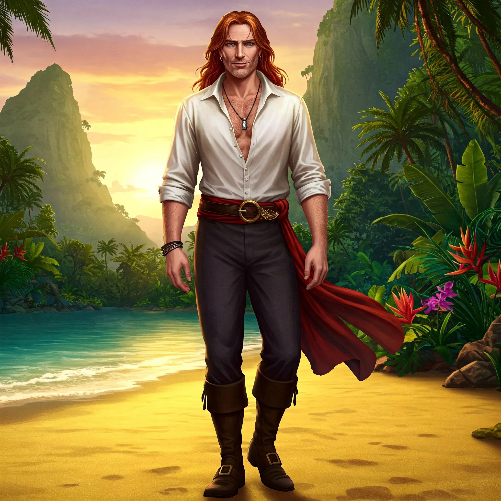

_Dawny samozwańczy król więźniów na Wyspie Wygnańców, po uwolnieniu z lochów Praxys przywódca uwolnionych więźniów._

## Opis
Słaby władca, postrzegany przez zwolenników siły jako tchórz i kupiec. Jest jednak charyzmatyczny i potrafi utrzymać namiastkę porządku. <!-- UNSOURCED -->

Był najbogatszym kupcem z [[Arezja|Arezji]].

## Osobowość
Próbuje zachować namiastkę porządku, ale jego rządy budzą niesmak wśród mieszkańców. Paranoicznie obawia się ujawnienia prawdy o swoim wygnaniu. <!-- UNSOURCED -->

## Historia
W [[Sesja 21 - Ukryte pragnienia Ismene]] wspomniano o nim jako o Lordzie Stavrosie, najbogatszym kupcu z [[Arezja|Arezji]], wygnanym na [[Wyspa Wygnańców|wyspę wygnańców]] za próbę otrucia syna [[Taran Neurdagon|Tarana Neurdagona]], swojego głównego rywala w handlu winem.

Na wyspie zastąpił [[Cronos|Cronosa]] na stanowisku "króla" po jego tajemniczej śmierci. <!-- UNSOURCED -->

W [[Sesja 45 - Tajemnica Wyspy Wygnańców]], jako król Wyspy Wygnańców, powitał bohaterów wraz z [[Idylla|Idyllą]] i opowiedział o serii morderstw, prosząc o pomoc; zasugerował, że za zbrodniami może stać jego główny rywal [[Tyrone]]. W [[Sesja 46 - Morderca z Wyspy Wygnańców]] przy pytaniu o wino wydawał się autentycznie zdziwiony i zaniepokojony (Felicjan potwierdził, że mówi prawdę); wino kupował u [[Tyrone|Tyrone'a]], gdy kończył mu się zapas. Po zdemaskowaniu [[Keelan|Keelana]] początkowo wahał się, sugerując wygnanie, ale pod naporem tłumu zgodził się na jego śmierć. Następnie w imieniu swoim i całej wyspy złożył przysięgę, że gdy nadejdzie czas konfliktu z [[Sydon|Sydonem]] i [[Lutheria|Lutherią]], wygnańcy staną po stronie Bohaterów Przepowiedni na ile to będzie możliwe.

W [[Sesja 73 - Praxys - Skarbiec Sydona]] drużyna znalazła go na poziomie więziennym wieży [[Praxys]]: po przybyciu sług [[Sydon|Sydona]] odmówił dołączenia do jego armii i za karę trafił do lochów. Uwolniony, objął dowództwo nad resztą więźniów, którzy mieli czekać na powrót bohaterów po oczyszczeniu wieży.
