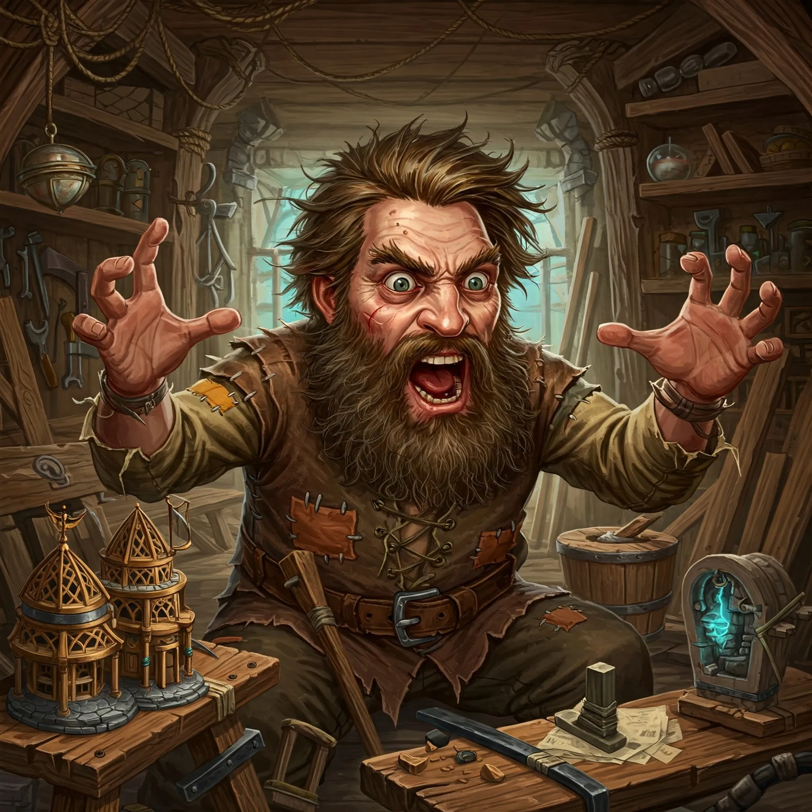

_Genialny architekt i szaleniec._ <!-- UNSOURCED -->

## Opis
Ekscentryczny pustelnik. <!-- UNSOURCED -->

Niziołek; jego chata jest zaśmiecona narzędziami rzeźbiarskimi, rzeźbami i rysunkami.

## Osobowość
Rozmawia sam ze sobą, nieprzewidywalny. <!-- UNSOURCED -->

Niestabilny psychicznie, paniczny; bełkocze o mordercy i oczach w ciemności, wygląda raczej na ofiarę psychozy niż zimnokrwistego zabójcę.

## Historia
Zbudował większość struktur na wyspie. Trafił tu za brutalne mordowanie kobiet w Stygian Row. <!-- UNSOURCED -->

W [[Sesja 45 - Tajemnica Wyspy Wygnańców]] [[Idylla]] wskazała go jako niestabilnego psychicznie rzemieślnika, znanego z brutalnych morderstw w przeszłości. W [[Sesja 46 - Morderca z Wyspy Wygnańców]] matka [[Acastus|Acastusa]] opowiedziała, że w [[Mytros]] atakował ofiary od tyłu, raniąc nogi, a następnie podrzynał gardła. Gdy bohaterowie odwiedzili jego chatę, próbował uciec przez okno, ale [[Orestes]] go złapał. Przeszukanie chaty nie powiązało go bezpośrednio z rytualnymi morderstwami; oczyszczono go z podejrzeń po zdemaskowaniu [[Keelan|Keelana]]. Po egzekucji [[Keelan|Keelana]] wydał radosny okrzyk.
