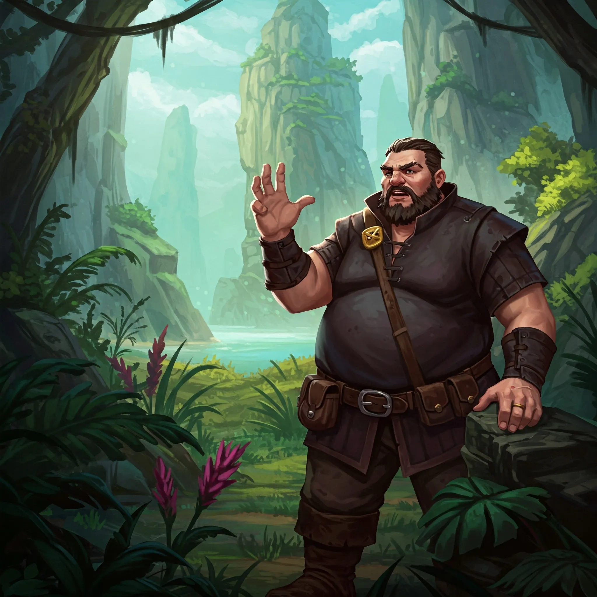

_Samozwańczy rywal Stavrosa, producent wina na Wyspie Wygnańców._

## Opis
Głośny, agresywny, zawsze szuka posłuchu.

Potężnie zbudowany mężczyzna o wyniosłej postawie, producent wina.

## Osobowość
Lubi podburzać innych, ale sam unika bezpośredniej konfrontacji.

Ambitny i arogancki, ale nie zabójca; cieszyło go osłabienie [[Stavros|Stavrosa]]. Gdy podsunięto mu nóż, stchórzył.

## Historia
Wygnany za podżeganie tłumu w [[Mytros]].

W [[Sesja 45 - Tajemnica Wyspy Wygnańców]] przedstawiono go jako głównego rywala [[Stavros|Stavrosa]] i pracodawcę [[Marius|Mariusa]]; [[Stavros]] zasugerował, że za morderstwami może stać Tyrone, próbujący podważyć jego autorytet. W [[Sesja 46 - Morderca z Wyspy Wygnańców]] zbył bohaterów, twierdząc, że jego wino jest najlepsze, wyraził niechęć do [[Stavros|Stavrosa]] i zaprzeczył związkowi ze śmiercią swoich ludzi. [[Felicjan Janus Twardowski|Felicjan]] odczytał jego myśli: morderstwa były dla niego problemem dla jego planów, lecz osłabienie [[Stavros|Stavrosa]] go cieszyło. Po zdemaskowaniu [[Keelan|Keelana]] pod naporem tłumu żądał egzekucji, ale sam stchórzył, gdy podsunięto mu nóż. Jego ludźmi byli [[Gareth]] i [[Silas]].
