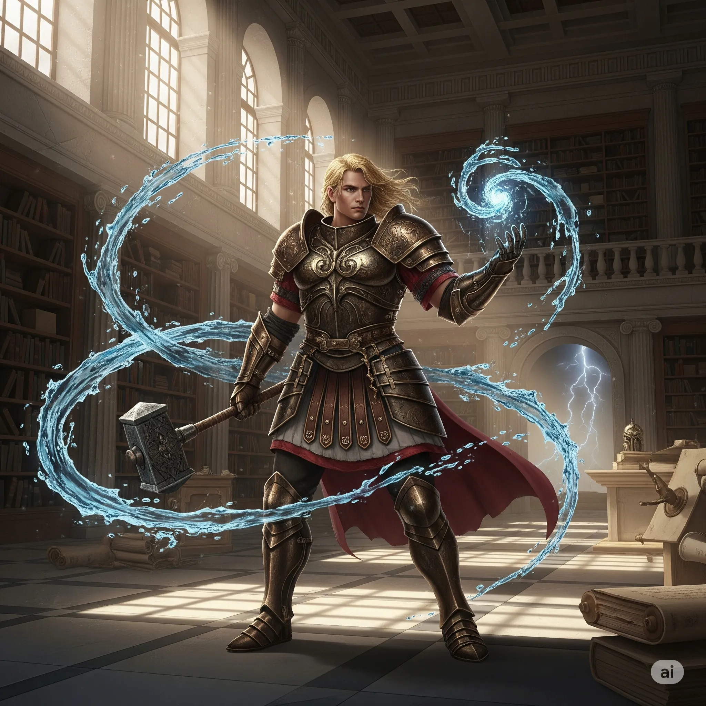

_Fanatyczny kapłan i kapitan [[Zakon Sydona|Zakonu Sydona]] na Wyspie Yonder. Zabity przez bohaterów._

## Opis
Potężnie zbudowany mężczyzna w zdobionej zbroi, z wielkim młotem w dłoni, o oczach płonących fanatycznym zapałem. Urzędował w pracowni w bibliotece na Yonder. Nie żyje.

## Osobowość
Bezwzględny, nie uznaje kompromisów. <!-- UNSOURCED -->

Fanatycznie oddany [[Sydon|Sydonowi]].

## Historia
W [[Sesja 52 - Infiltracja Yonder]] strażnicy przy bibliotece wspomnieli o kapitanie Ajaksie, przebywającym w środku. Gdy doszło do walki, oślepił [[Orestes|Orestesa]] boskim światłem; czar polimorfii [[Chondrus|Chondrusa]] na niego nie zadziałał. Po walce z [[Orestes|Orestesem]] [[Orion Xul|Orion]] zadał mu ostateczny cios. Następnie [[Orestes]] użył magicznej maski, by przybrać wygląd Ajaxa, i jako on wszedł do świątyni, rozkazując strażnikom.

W [[Sesja 69 - Ogród Lutherii]] pojawił się wśród dawnych wrogów na arenie na [[Wyspa Krzywoprzysięstwa|Wyspie Krzywoprzysięstwa]]: w ostatniej fali czaił się w cieniu.
