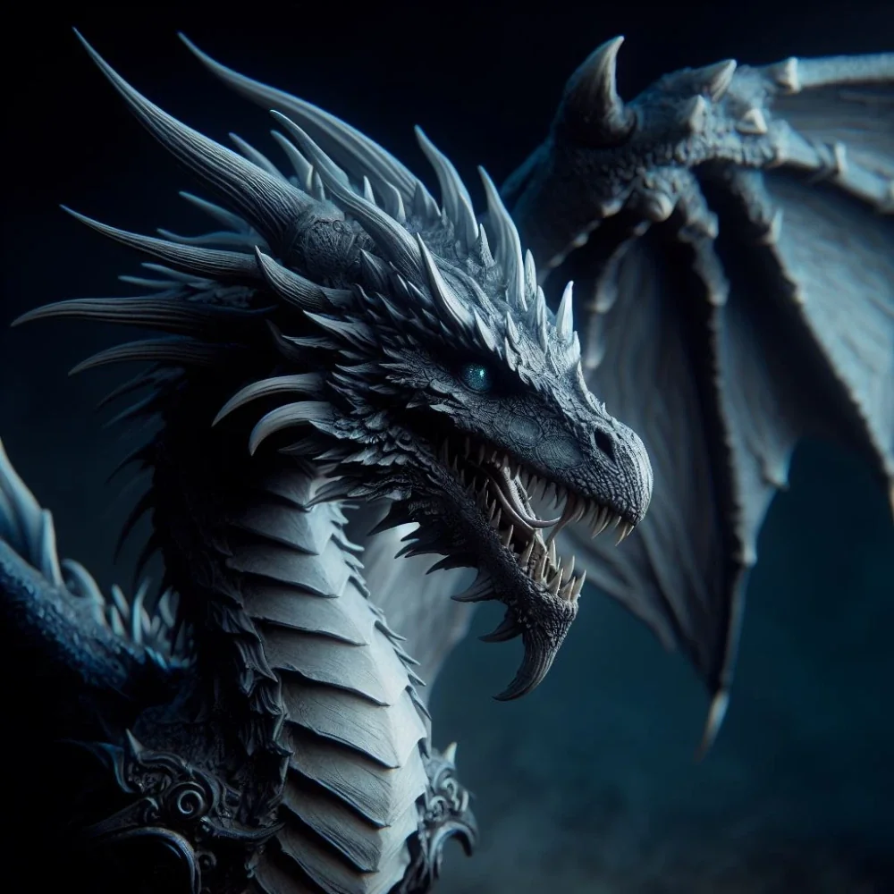

_Majestatyczna srebrna smoczyca, ukochana Gaiusa i jego wierzchowiec. Zginęła na Wyspie Yonder._

Podobnie jak smok króla, **[[Icarus]]**, Argyn została magicznie postarzona, ale jej umysł wciąż jest niedojrzały.

Argyn to ogromna srebrna smoczyca o błyszczących łuskach.

## Opis
W smoczej formie jest latarnią lojalności. [[Gaius]] oczekuje dnia, w którym osiągnie pełną dorosłość i będzie mogła przybrać ludzką postać, gdyż poprzysiągł się z nią ożenić.

Zionie lodowatym, paraliżującym oddechem.

## Osobowość
Wierna towarzyszka i powierniczka Gaiusa, choć w rzeczywistości jedynie go toleruje. Kocha tylko **[[Sydon|Sydona]]**, który obiecał jej górę skarbów w zamian za służbę. Wierzy, że Pięciu Bogów to zło, a Sydon jest jedynym dobrem.

## Historia
Związana z Gaiusem i sprawą [[Sydon|Sydona]]. Jej istnienie rozwściecza królową [[Vallus]].

W [[Sesja 5 - Skała Estora]] bohaterowie byli świadkami przybycia srebrnego smoka Argyna z jeźdźcem, [[Gaius|Commanderem Gaiusem]]. W [[Sesja 17 - Targ Minotaurów]] [[Gaius]] i [[Acastus]] przybyli pod Świątynię Pięciu na smokach [[Icarus]] i Argyn. W [[Sesja 50 - Nawałnica Tytanów i Szepty Yonder]] bohaterowie dowiedzieli się, że [[Gaius]] często przebywa na Yonder ze swoją smoczycą.

W [[Sesja 51 - Desant na Yonder]] Argyn spała spokojnie między świątynią a biblioteką. Była ulubienicą [[Gaius|Gaiusa]], który czyścił jej łuski i przynosił najlepsze kąski z kuchni; plotka mówiła, że dał jej drogi szafir jako prezent zaręczynowy. Gaius dosiadł jej i poleciał na wschód, w stronę, gdzie cumował [[Ultros]]. W [[Sesja 52 - Infiltracja Yonder]] wracał na jej grzbiecie na wyspę i ścigał uciekającą drużynę; w jego komnatach znaleziono olbrzymi szafir, zapewne prezent dla niej.

W [[Sesja 53 - Koniec Yonder]] Argyn, wierzchowiec Gaiusa, walczyła z bohaterami lodowatym oddechem. Po śmierci jeźdźca wpadła w szał i rzuciła się na [[Orestes|Orestesa]], który trzymał się jej ogona; padła martwa na skalną półkę, rażona piorunem [[Versir|Versira]] w serce. Z jej ciała drużyna pozyskała smocze składniki: krew, róg i woreczek oddechowy. W [[Sesja 54 - Wyznanie Chondrusa]] załoga [[Ultros|Ultrosa]] opowiadała, że w nieobecności bohaterów na horyzoncie zamajaczyła skrzydlata sylwetka, prawdopodobnie Argyn z Gaiusem.
