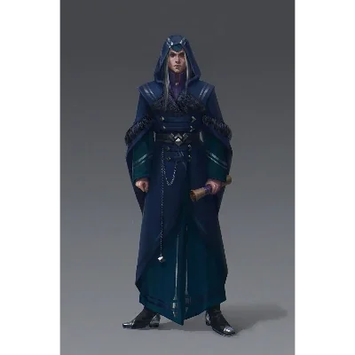

_Kapłan Zakonu Sydona w niebieskich szatach, spotkany w Świątyni Wyroczni._

## Opis
Braeca jest kapłanem [[Sydon|Sydona]], odzianym w niebieskie szaty. Nosi przy sobie brązowy symbol święty przedstawiający gniewne oblicze Władcy Burz.

## Osobowość
Jest fanatycznie oddany [[Sydon|Sydonowi]] i jego rozkazom. Nie cofa się przed przemocą, aby osiągnąć cele zakonu, choć w przeciwieństwie do [[Heleka|Heleki]], nie wykazuje sadyzmu wobec jeńców, traktując ich po prostu jako przeszkody.

## Historia
Został wysłany przez [[Gaius|Gaiusa]], dowódcę [[Zakon Sydona|Zakonu Sydona]], do [[Świątynia Wyroczni|Świątyni Wyroczni]]. Jego zadaniem było zabicie bohaterów, zanim staną się na tyle sławni, by zagrozić władzy Tytanów. Podczas ataku na świątynię wziął do niewoli [[Proteus|Proteusa]] i pozostałych akolitów.

Pojawia się wśród postaci [[Sesja 2 - Przepowiednia]], rozgrywającej się w Świątyni Wyroczni. W [[Sesja 68 - Arena Krzywoprzysięstwa]] walczył na arenie na [[Wyspa Krzywoprzysięstwa|Wyspie Krzywoprzysięstwa]] w pierwszej fali u boku [[Heleka|Heleki]] i został pokonany przez bohaterów.
