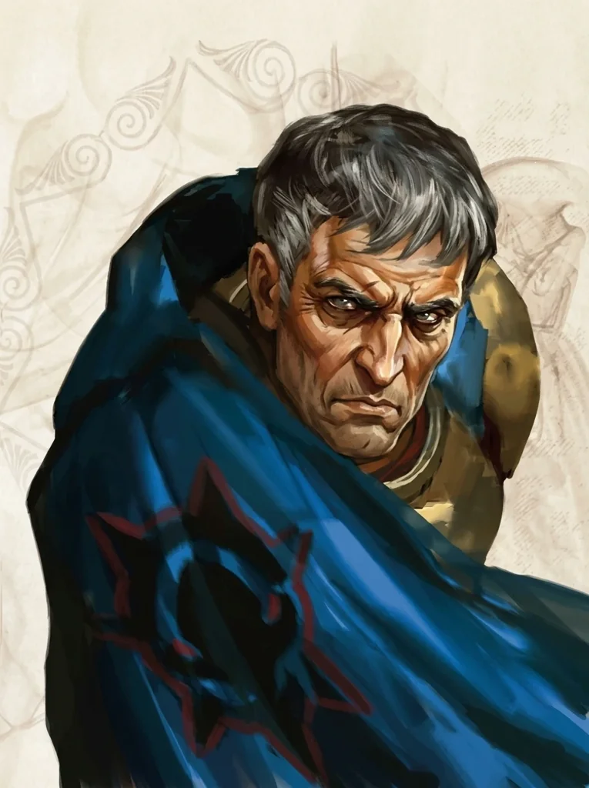

_Dowódca [[Zakon Sydona|Zakonu Sydona]], nieubłagany wykonawca woli Władcy Burz. Zginął na Wyspie Yonder, jego dusza czeka w Hadesie._

## Opis
Gaius to potężnie zbudowany mężczyzna w ciężkiej zbroi płytowej z motywami burzy. Jest potężnym paladynem Sydona. Posiada *Javelin of Lightning*. Często widywany w Mytros w towarzystwie **[[Acastus|Króla Acastusa]]** lub w Świątyni Sydona.

Był dowódcą Zakonu i dosiadał **[[Argyn|Argyna]]**, srebrnej smoczycy, którą kochał; na Yonder miał prywatne komnaty w świątyni. Nie żyje: zginął z rąk bohaterów, a jego dusza stoi w kolejce do [[Charon|Charona]] w [[Hades|Hadesie]]. Przy jego ciele znaleziono pierścień spowalniający upadek, potężną włócznię i zbroję [[Xander|Xandera]] osłabiającą ataki tytanów.

## Osobowość
*   **Gorliwy:** Niezachwianie oddany [[Sydon|Sydonowi]]. Nie zna litości dla heretyków.
*   **Pozbawiony humoru:** Ponury, nigdy nie pije alkoholu. Krzyżuje bardów, by ich uciszyć. Nawet jego ludzie się go boją.

Gardzi Pięcioma Bogami: Pythora uważa za pijaka, Kyrah za marną poetkę, a Vallus za słabą władczynię zamkniętą w wieży. Jego celem jest zniszczenie świątyń Pięciu i oddanie miasta w ręce Sydona.

Fanatyczny sługa [[Sydon|Sydona]]; popierał go i nienawidził [[Chondrus|Chondrusa]], a wobec [[Lutheria|Lutherii]] był obojętny.

## Historia
W [[Sesja 5 - Skała Estora]] bohaterowie byli świadkami przybycia srebrnego smoka [[Argyn|Argyna]] z jeźdźcem, Commanderem Gaiusem, w związku z planowaną ofiarą z księżniczki [[Anora|Anory]].

Gaius dowodził oddziałem kapitanów [[Zakon Sydona|Zakonu Sydona]], który przybył do [[Estoria|Estorii]], i nadzorował procesję na [[Skała Estora|Skałę Estora]]. Gdy bohaterowie dobrowolnie zajęli miejsce Anory i przeżyli noc, niechętnie pozwolił im odejść, uznając warunki ofiary za spełnione.

W [[Sesja 7 - Uratować Księżniczkę]] został obwiniony przez [[Hergeron|Hergerona]] o porażkę w sprawie Anory. W [[Sesja 8 - Ścieżka Umarłych]] spotkał bohaterów na szlaku do [[Nekropolia w Telamok|Telamok]]: jadąc na srebrnym smoku, ostrzegł ich przed kontynuowaniem misji.

W [[Sesja 13 - Wezwani przez Króla]] razem z [[Acastus|Acastusem]] i [[Bella|Bellą]] chciał zrzucić na bohaterów winę za klęski. W [[Sesja 17 - Targ Minotaurów]] przybył z [[Acastus|Acastusem]] pod [[Świątynia Pięciu|Świątynię Pięciu]] na smokach ([[Icarus]] i [[Argyn]]); [[Felicjan Janus Twardowski|Felicjan]] odczytał jego myśli: obojętność wobec [[Lutheria|Lutherii]], skupienie na poparciu dla [[Sydon|Sydona]] i nienawiść do [[Chondrus|Chondrusa]]. W [[Sesja 25 - Inauguracja Wielkich Igrzysk]] ogłosił, że Władca Burz zażądał nowej tradycji: walki jeden na jednego w celu zabicia minotaura.

W [[Sesja 48 - Pakty z Mojrami i Zew Chimery]] bohaterowie obawiali się jego smoka. W [[Sesja 50 - Nawałnica Tytanów i Szepty Yonder]] dowiedzieli się, że jest głównym dowódcą sił na Yonder, często przebywa tam ze smoczycą [[Argyn]] i ma potężną zbroję. W [[Sesja 51 - Desant na Yonder]] odleciał na Argyn na wschód, w stronę, gdzie sądzono, że wciąż cumuje [[Ultros]]. W [[Sesja 52 - Infiltracja Yonder]] wrócił na jej grzbiecie na wyspę, zabrzmiał róg alarmowy i ruszył w pościg za uciekającą drużyną; w jego prywatnych komnatach w świątyni znaleziono dziennik, niedokończony list do Sydona, skrzynię złota i olbrzymi szafir, zapewne prezent dla Argyn.

W [[Sesja 53 - Koniec Yonder]] zaatakował drużynę z grzbietu smoczycy z okrzykiem „Chwała Sydonowi!". [[Chondrus]] uwięził go wraz ze smoczycą w Wall of Force, a Gaius oskarżył go o zdradę i paktowanie z [[Lutheria|Lutherią]], mówiąc: „Zapytajcie waszego nowego, wiernego sojusznika. Czyje szepty słyszy w snach?”. Zginął: [[Orestes]] zrzucił go w przepaść, a [[Felicjan Janus Twardowski|Felicjan]] dobił go magicznym pociskiem. W [[Sesja 55 - Egida Mytros]] król [[Acastus]] oskarżył bohaterów o lekkomyślne sprowokowanie wojny przez zabicie Gaiusa i jego smoczycy, a dziennik Hergerona i Gaiusa przekazano [[Vallus]].

W [[Sesja 60 - Typhon Symfonia Potępienia i Brama do Hadesu]] bohaterowie dostrzegli jego duszę w kolejce do [[Charon|Charona]] w [[Hades|Hadesie]]. W [[Sesja 61 - Yala, Arezja i Żółw]] stał tam pozbawiony zbroi i autorytetu, z monetami dla Charona, z twarzą wciąż naznaczoną fanatyzmem, lecz wykrzywioną także goryczą zdrady ze strony Sydona; oczekiwał wskrzeszenia lub Pól Elizejskich i groził, że Sydon zbuduje sobie tron z kości bohaterów. Gdy bohaterowie odchodzili, wciąż stał w kolejce, zrezygnowany. W [[Sesja 62 - Arezyjska Dyplomacja]] bohaterowie opowiedzieli Hiero o jego pokonaniu wraz ze smokiem. W [[Sesja 70 - Audiencja u Pani Snów]] Lutheria odesłała do niego Chondrusa.
