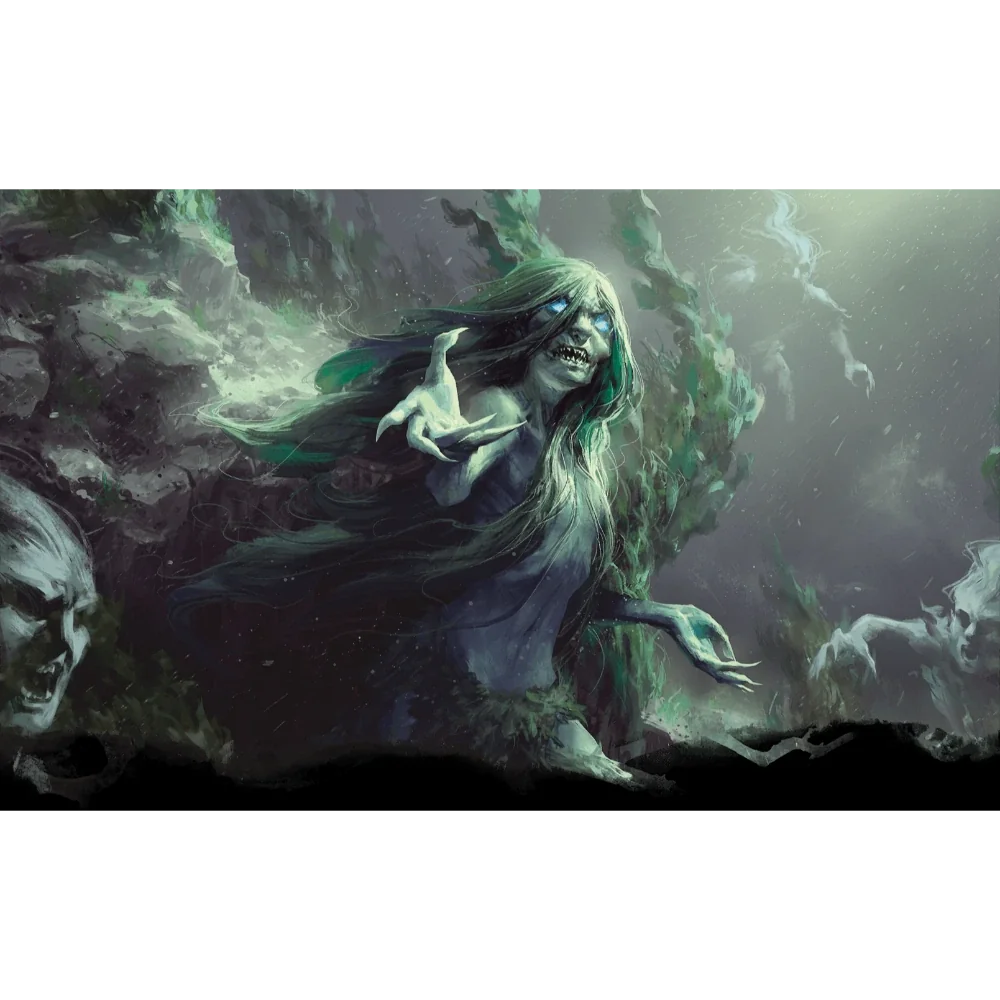

_Zła morska wiedźma służąca Sydonowi, znana ze swojego okrucieństwa. Pokonana na arenie Wyspy Krzywoprzysięstwa._

## Opis
Heleka jest odrażającą morską wiedźmą o śliskiej, zielonkawej skórze i włosach splątanych niczym morskie wodorosty. Jej obecność napawa lękiem, a jej spojrzenie potrafi wyssać życie z nieostrożnych.

## Osobowość
Jest okrutna, sadystyczna i całkowicie oddana [[Sydon|Sydonowi]]. Czerpie przyjemność z dręczenia swoich ofiar, co pokazała mordując bezbronnych akolitów w [[Świątynia Wyroczni|Świątyni Wyroczni]], aby sprawić ból uwięzionej Wyroczni.

## Historia
Przez dwa tygodnie okupowała [[Świątynia Wyroczni]], mordując akolitów i dręcząc nimfę. Otrzymała list od [[Sydon|Sydona]] z rozkazem przyprowadzenia jego córki do [[Praxys]] przez [[Zapomniane Morze]].

W [[Sesja 2 - Przepowiednia]] została wysłana przez [[Sydon|Sydona]], by uwięzić jego własną córkę, [[Versi|Wyrocznię Versi]], i przetrzymywała ją w [[Świątynia Wyroczni|Świątyni Wyroczni]]; bohaterowie uwolnili Versi z jej rąk.

W [[Sesja 68 - Arena Krzywoprzysięstwa]] pojawiła się wśród dawnych wrogów w pierwszej fali areny na [[Wyspa Krzywoprzysięstwa|Wyspie Krzywoprzysięstwa]], dosiadając [[Wielki Dzik|Wielkiego Dzika]], i została pokonana.
