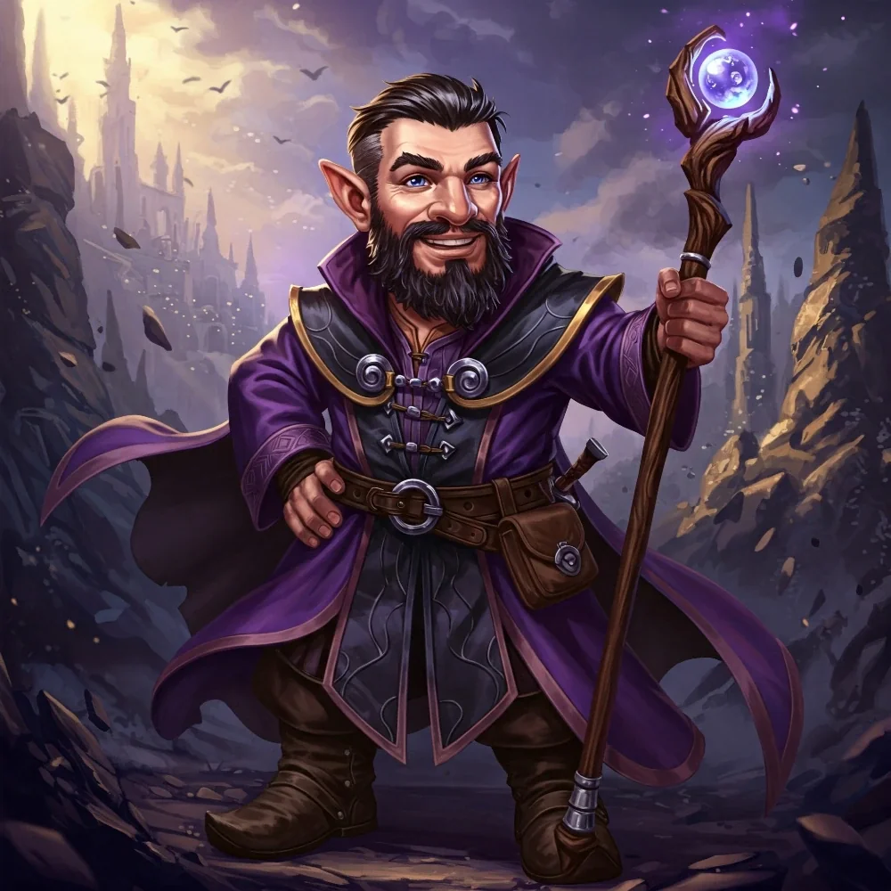

_Gnom, pokładowy mag ocalałych z Eberronu, członek załogi Arevona._

## Opis
Gnom, który służył na statku "The Tranquility" razem z [[Arevon Elorrenthi|Arevonem]].

Pokładowy mag grupy ocalałych z [[Eberron|Eberronu]]. Po wojnie został w [[Kontynent Thylea|Thylei]].

## Historia
Zaginął, gdy statek został roztrzaskany na morzu.

W [[Sesja 41 - Wiedźma Lotosu]] [[Arevon Elorrenthi|Arevon]] rozpoznał go jako gnoma z zaginionej załogi wśród odmienionych dzieci w wieży [[Wiedźma Lotosu|Wiedźmy Lotosu]]. Odzyskał dorosłą postać, gdy napili się krwi pani Umbridge.

Był tam zmuszony do pracy.

W [[Sesja 84 - Świt Nowej Ery]] dał się przekonać [[Arevon Elorrenthi|Arevonowi]], że ocalali z [[Eberron|Eberronu]] nie powinni wracać do domu: jeden nieostrożny język wystarczyłby, by wpływowi ludzie wyciągnęli drogę do [[Kontynent Thylea|Thylei]], a wtedy przypłynęłaby tu nie garstka rozbitków, lecz flota chętnych, by podzielić ten świat między siebie.
