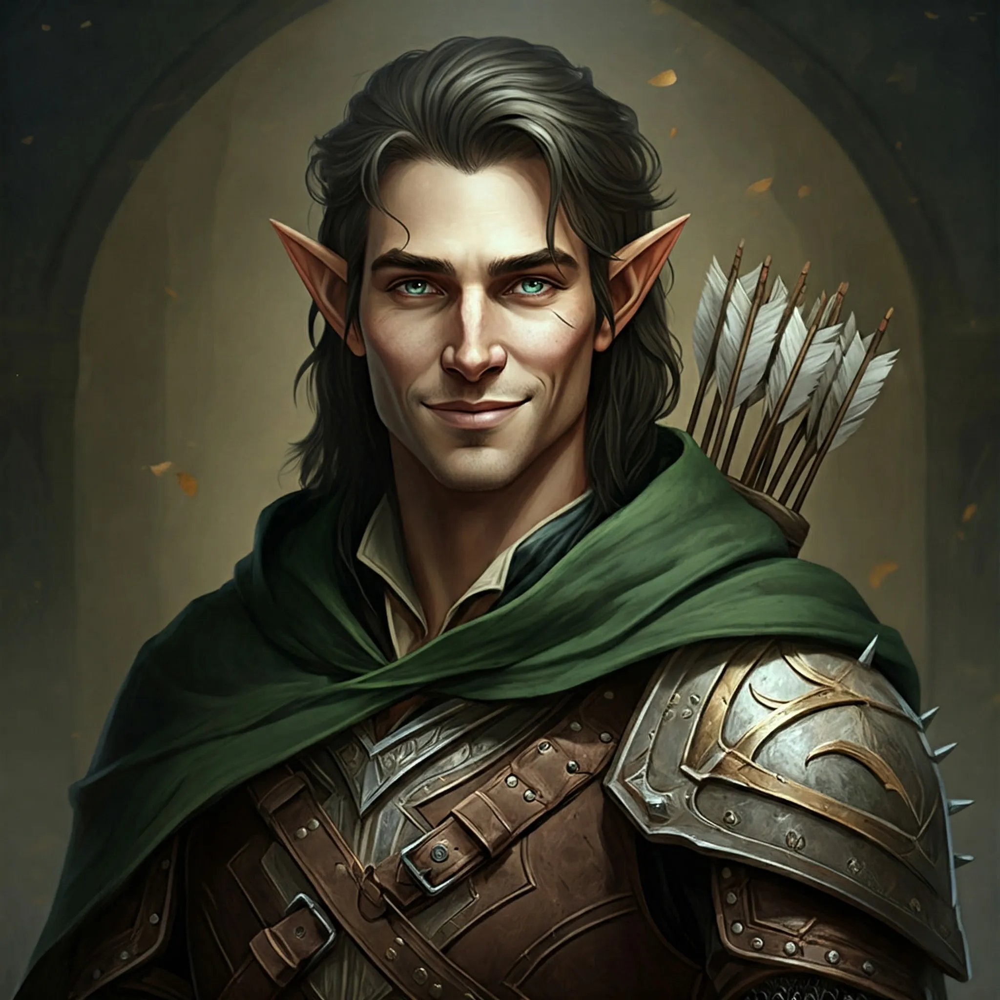

_Dawny towarzysz Arevona, odnaleziony spetryfikowany na Themis. Po wojnie wrócił do Eberronu, do syna._

## Historia
W [[Sesja 34 - Ivello i Drapaczka do Pleców]] [[Arevon Elorrenthi|Arevon]] odnalazł jego kamienny posąg przy fortecy na [[Themis]]; [[Felicjan Janus Twardowski|Felicjan]] przeniósł go zaklęciem lotu na statek, gdzie Arevon ożywił go za pomocą Oil of Softening. Ivello opowiedział o swoich przeżyciach na Themis, gdzie wylądował razem z [[Baltia|Baltią]], i dopytywał się o jej los.

W [[Sesja 84 - Świt Nowej Ery]] zniósł najgorzej ze wszystkich rozbitków decyzję o pozostaniu w [[Kontynent Thylea|Thylei]]: powtarzał wciąż jedno — że tam czeka na niego syn, który miał jedenaście lat, kiedy ojciec wypływał. Padły pomysły, by wymazać mu wspomnienia o drodze powrotnej, ale zwykła magia tego nie potrafiła; jedyne, co przychodziło do głowy, to prosić o przysługę [[Mojry]]. [[Arevon Elorrenthi|Arevon]] ostatecznie mu nie odmówił: zlecił budowę niepozornego, wiosłowego statku i odesłał Ivella do domu razem z [[Lia Amakiir|Lią Amakiir]] — po długich wykładach o tym, o czym nie wolno mówić, i po przestrodze, że jeśli ktokolwiek dowie się o [[Kontynent Thylea|Thylei]], ucierpią oni i ich rodziny. Nie było wcale pewne, że dotrą.
