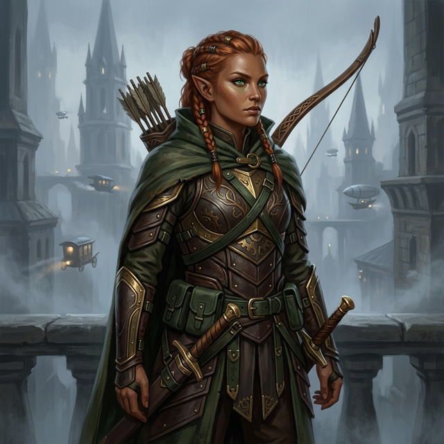

_Wojowniczka z załogi Arevona, pochodząca z Sharn w Eberronie. Po kampanii odpłynęła do Eberronu._

## Opis
**Lia Amakiir** to elfka leśna o miedzianej skórze i przenikliwym spojrzeniu zielonych oczu. W przeciwieństwie do wielu swoich pobratymców, wychowała się w metropolii Sharn (Breland), co nadało jej miejskiego sznytu i praktycznego podejścia do walki. Jako wojowniczka specjalizuje się w walce łukiem oraz szybkimi ostrzami, łącząc elficką grację z bezwzględnością niezbędną do przetrwania na ulicach Miasta Wież. <!-- UNSOURCED -->

## Historia
Lia była kluczowym członkiem oryginalnej załogi [[Arevon Elorrenthi|Arevona]] w świecie Eberron, służąc na statku "The Tranquility". Przed dołączeniem do załogi prawdopodobnie krążyła po najniższych poziomach Sharn jako najemniczka lub strażniczka. Zaginęła wraz z resztą załogi, gdy statek rozbił się u brzegów [[Thylea|Thylei]]. <!-- UNSOURCED -->

Jej los był długo nieznany. W [[Sesja 73 - Praxys - Skarbiec Sydona]] [[Arevon Elorrenthi|Arevon]] odnalazł ją wśród więźniów w wieży [[Praxys]]; została uwolniona. Wyjaśniła, że [[Sydon]] zabezpieczył resztki statku [[Tranquility]] w dokach, choć ten nie nadawał się wtedy do podróży.

W [[Sesja 84 - Świt Nowej Ery]] pozostała nie do końca przekonana argumentami [[Arevon Elorrenthi|Arevona]] o tym, dlaczego ocalali z [[Eberron|Eberronu]] nie powinni wracać do domu. Gdy druid ostatecznie zdecydował się wysłać wyprawę powrotną, była zdecydowanie chętna — i popłynęła niepozornym wiosłowym statkiem razem z [[Ivello Ostren|Ivellem Ostrenem]], po długich wykładach o tym, o czym nie wolno im mówić, i przestrodze, że jeśli ktokolwiek dowie się o [[Kontynent Thylea|Thylei]], ucierpią oni i ich rodziny.
