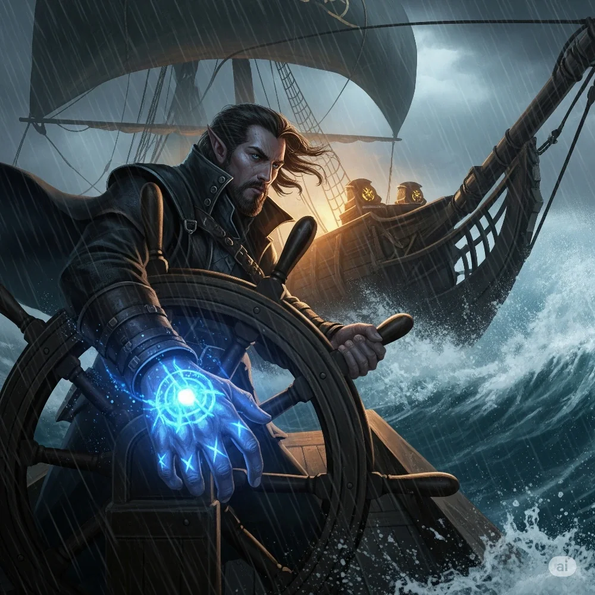

_Kapitan statku "Tranquility", półelf z Eberronu. Po wojnie został w Thylei._

## Opis
Półelf o niezwykłej odporności, posiadający świetliste znaki na skórze.

Jako jedyny nosił Znamię Burzy, które normalnie pozwala prowadzić statek [[Tranquility]] bez żagli i wioseł. Po wojnie został na lądzie w [[Kontynent Thylea|Thylei]], gdzie poznał ludzi i uznał to miejsce za swoje.

## Osobowość
Hardy i zdeterminowany, by przeżyć. Lojalny wobec [[Arevon Elorrenthi|Arevona Elorrenthi]].

W [[Sesja 54 - Wyznanie Chondrusa]] pragnął powrotu do rodzinnego [[Eberron|Eberronu]]; ostatecznie nie chciał ściągać kłopotów na nowy dom.

## Historia
Jego statek "Tranquility" został roztrzaskany przez szał [[Sydon|Sydona]].

W [[Sesja 50 - Nawałnica Tytanów i Szepty Yonder]] bohaterowie dowiedzieli się, że kapitan Tars, dawny znajomy [[Arevon Elorrenthi|Arevona]], został schwytany i prawdopodobnie jest więziony w czeluściach świątyni na [[Wyspa Yonder|Yonder]]; jego uwolnienie było jednym z celów desantu. W [[Sesja 52 - Infiltracja Yonder]] [[Orestes]] w przebraniu [[Ajax|Ajaxa]] i niewidzialny [[Arevon Elorrenthi|Arevon]] uwolnili go z celi w więziennej części świątyni; osłabiony, uciekł zamieniony w mysz. W [[Sesja 53 - Koniec Yonder]] opuścił wyspę z drużyną.

W [[Sesja 54 - Wyznanie Chondrusa]] opowiedział Arevonowi o torturach na Yonder i o sztormie przy Mgle Mournlandu, w którym wpadł do wody i dryfował, trzymając się deski, aż został wyłowiony i uwięziony; Arevon musiał mu wytłumaczyć, że droga powrotna do Eberronu jest niezwykle trudna.

W [[Sesja 84 - Świt Nowej Ery]] okazało się, że [[Tranquility]] nie potrzebuje go już do żeglugi: przerobiony przez [[Sydon|Sydona]] żywiołak słuchał także [[Arevon Elorrenthi|Arevona]], który dzięki temu mógł zostawić kapitana na lądzie zamiast wciągać go w kolejną awanturę. Gdy druid wyłożył ocalałym z [[Eberron|Eberronu]], dlaczego nie powinni wracać do domu, Tars przyjął argument bez oporu — zdążył już poznać tu ludzi i uznać to miejsce za swoje, i nie chciał ściągać kłopotów na nowy dom.
