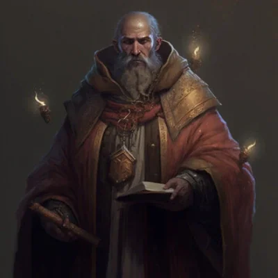

_Starszy opiekun [[Świątynia Wyroczni|Świątyni Wyroczni]] i lojalny towarzysz Wyroczni Versi._

## Opis
Proteus jest starszym, mądrym mężczyzną (choć jego natura jako Proteana sugeruje większą głębię), który od lat opiekuje się [[Świątynia Wyroczni|Świątynią Wyroczni]]. Ma twarz pooraną zmarszczkami i łagodne, ale przenikliwe spojrzenie.

## Osobowość
Jest sceptyczny wobec możliwości dokonania "Wielkich Prac" przez śmiertelników, ale głęboko wierzy, że Thylea desperacko potrzebuje bohaterów. Posiada ogromną wiedzę na temat geografii i kultury [[Thylea|Thylei]]. Jest niezwykle oddany [[Versi|Wyroczni]].

## Historia
Podczas ataku [[Zakon Sydona|Zakonu Sydona]] na świątynię, Proteus był przetrzymywany jako jeniec przez [[Braeca|Braecę]]. Głośno i odważnie domagał się zaprzestania torturowania Wyroczni przez wiedźmę [[Heleka|Helekę]]. Po uwolnieniu, służył bohaterom radą i podarował każdemu z nich miksturę leczenia (zobacz: [[Sesja 2 - Przepowiednia]]).
