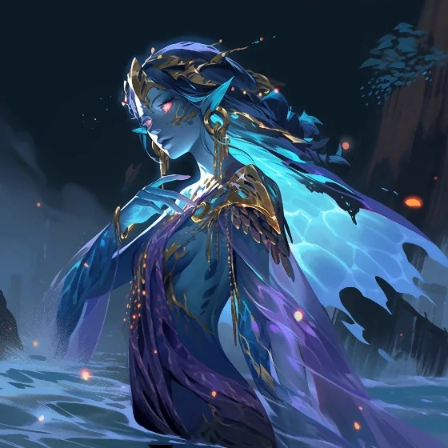

_Słynna nimfa wodna obdarzona darem proroctwa i miłością do śmiertelnych ras. Córka Sydona, która sprzeciwiła się ojcu, wywróżywszy mu upadek._

## Opis
Versi, znana powszechnie jako **Wyrocznia**, jest nimfą i córką [[Sydon|Sydona]]. Ma dar proroctwa i jasnowidzenia: przepowiada przyszłość [[Thylea|Thylei]], a w [[Sesja 42 - Plemię Węgorza]] doznała wizji o smoczych jajach skażonych mocą [[Mojry|Mojr]] i klątwie ciążącej nad młodymi smokami. Po upadku Sydona padła propozycja, by została jedną z nowych [[Mojry|Mojr]] ([[Sesja 84 - Świt Nowej Ery]]).

Zamieszkuje gorące źródła w jaskini pod [[Świątynia Wyroczni|Świątynią Wyroczni]]. Jest córką naiady Delphei. Urodziła się z trzecim okiem na czole, które ukrywa pod złotym diademem.

Mimo swojego pochodzenia zawsze darzyła śmiertelników z [[Thylea|Thylei]] ogromną sympatią – niektórzy twierdzą, że kocha ich „aż za bardzo" (traktuje ich zaborczo, jak ukochane zwierzątka).

## Osobowość
*   **Nawiedzona:** Dręczą ją wizje przyszłości. Trzyma się nadziei, ale w jej oczach widać strach.
*   **Zaborcza:** Traktuje śmiertelników, zwłaszcza herosów, jak cenne zwierzęta domowe. Bywa zazdrosna, jeśli zbliżą się do innych bóstw.

Wierzy, że herosi są szansą na najlepszy możliwy wynik w strumieniu czasu.

## Historia
Versi od lat przepowiadała przybycie wielkich wojowników, którzy uratują [[Thylea|Thyleę]] w godzinie próby.

Nosi imię po swojej ubitej ciotce, [[Versi Pierwsza|Versi Pierwszej]] — [[Versir]] zarzucił [[Lutheria|Lutherii]], że swoje dzieci nazwała imionami zniszczonych Tytanów ([[Sesja 70 - Audiencja u Pani Snów]]).

W [[Sesja 1 - Wielki Dzik]] jej wysłanniczką była [[Kyrah]].

W [[Sesja 2 - Przepowiednia]] bohaterowie dotarli do [[Świątynia Wyroczni|Świątyni Wyroczni]] i odkryli, że Versi została uwięziona przez wiedźmę [[Heleka|Helekę]] na rozkaz [[Sydon|Sydona]]. Uwolnili ją, a ona wyjawiła im pełną **Przepowiednię o Zagładzie Thylei** (Doom of Thylea) i wyznaczyła trzy zadania („Wielkie Prace"), które mają zapobiec zagładzie Thylei i przygotować bohaterów do walki z Tytanami.

W [[Sesja 42 - Plemię Węgorza]] doznała wizji o smoczych jajach skażonych mocą Mojr.

W [[Sesja 47 - Wyspa Mojr]] towarzyszyła drużynie na statku [[Ultros]]: [[Felicjan Janus Twardowski|Felicjan]] skorzystał z jej daru jasnowidzenia, by sprawdzić, czy układ z Mojrami wyjdzie na dobre, a ona wyjaśniła, że Mojry sprowadziła [[Thylea]], by strzegły nici losu, a z czasem zaczęły żądać zapłaty. Mojry postrzegały ją jako rywalkę w dziedzinie przepowiedni i losu i zażądały jej wydania w zamian za zdjęcie klątwy z jaj. Mimo początkowych wahań zgodziła się towarzyszyć desantowi na wyspę i uznała ofertę Mojr za szczerą, choć cena mogła być wysoka.

W [[Sesja 84 - Świt Nowej Ery]] padła propozycja, by została jedną z nowych [[Mojry|Mojr]] — obok [[Wiedźma Lotosu|Wiedźmy Lotosu]]. Argument był poetycki i trudny do podważenia: to ona rozpoczęła całą tę historię, stawiając przed bohaterami przepowiednię, i to ona jako córka [[Sydon|Sydona]] sprzeciwiła się ojcu, wywróżywszy mu upadek.

## Lokacja
- [[Świątynia Wyroczni]]
