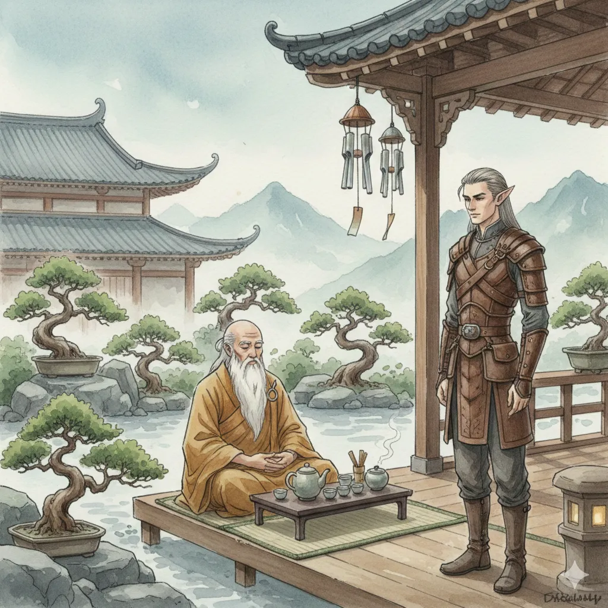

_Izolowana świątynia na szczycie góry, dostępna po pokonaniu tysięcy schodów._

## Opis
Miejsce medytacji i ciszy. Uczy cierpliwości.

Świątynia Spokoju leży wysoko na szczycie góry w [[Arezja|Arezji]]; prowadzą do niej tysiące schodów.

## Mieszkańcy
- **[[Laertes]]**: Wielki Mistrz Spokoju, starzec zdający się być częścią samej góry.
- **Akolici**: Poszukujący „idealnej oliwki” dla swojego mistrza.

## Historia
W [[Sesja 63 - Werdykt Arezji]] bohaterowie wspięli się tu, by przekonać [[Laertes|Laertesa]]. Mistrz przyjął ich bez słowa, parząc herbatę, a w końcu przemówił metaforą o wezbranej rzece i wiosce u podnóża gór. Odpowiedź, że lepiej przekierować nurt wcześniej, zadowoliła go i obiecał poparcie w Radzie.
