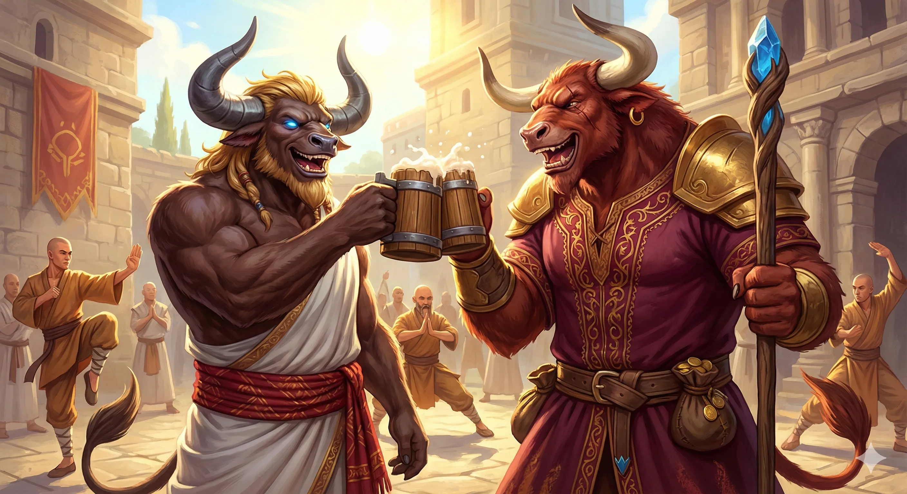

_Ośrodek mnichów kontrolujących żywioły, zarządzany przez Taureusa._

## Opis
Pełna dźwięków łamanych skał, szumu wody i ognia. Mnisi stąd zajmują się utrzymaniem infrastruktury miasta.

Świątynia Żywiołów w [[Arezja|Arezji]] znajduje się na końcu tętniącego życiem targu, z otwartym placem treningowym. Jest świątynią Wielkiego Mistrza Żywiołów [[Taureus|Taureusa]].

## Mieszkańcy
- **[[Taureus]]**: Wielki Mistrz Żywiołów, minotaur o posturze góry, gardzący „miękkim” [[Mytros]].
- **[[Bullbug]]**: Minotaurzyca uratowana przez drużynę z rąk handlarzy niewolników w Mytros, stojąca przy mistrzu.

## Historia
W [[Sesja 63 - Werdykt Arezji]] bohaterowie spotkali tu [[Taureus|Taureusa]] i [[Bullbug]]. Dzięki jej słowom mistrz przyjął ich jako bohaterów, którzy zgładzili [[Maximus|Maximusa]], a [[Orestes]] scementował znajomość piwem z rodzinnego browaru. [[Taureus]] zadeklarował poparcie na radzie.
