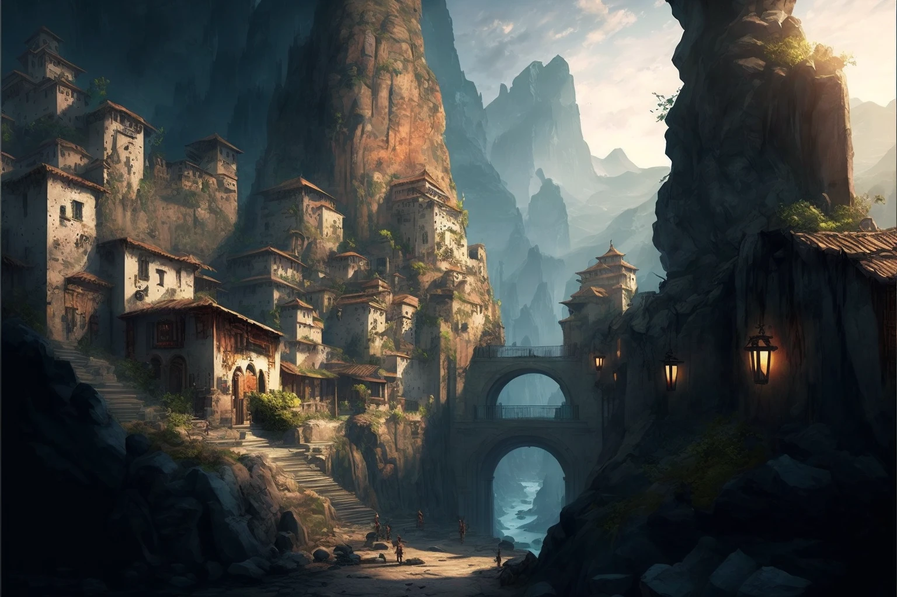

Estoria to największa osada wzdłuż rzeki [[Rzeka Arkelon|Arkelon]], wkomponowana w skalisty wąwóz. Miasto schodzi kaskadowo w dół od kamiennych murów fortecy, która strzeże północnych rubieży przed niebezpieczeństwami ze stepów. <!-- UNSOURCED -->

Estoria przez stulecia stanowiła główną linię obrony przed [[Centaur z Thylei|centaurami]], cyklopami i mantikorami. Choć Estorianie są uważani za prowincjuszy przez mieszkańców [[Mytros]], to właśnie tutaj wykuwani są najwięksi wojownicy w służbie Pana Bitwy. <!-- UNSOURCED -->

Po wojnie z Tytanami władzę w mieście sprawuje [[Anora]], której [[Pythor]] zostawił tron jeszcze przed wypłynięciem [[Ultros|Ultrosa]]. W [[Estoria|Estorii]] zaczęły powstawać pomniki bohaterów.

> "Kiedy pierwszy raz przybyłem do Estorii, była ona domem dla niewiele więcej niż pasterzy kóz i nękanych żołnierzy. Ale teraz jesteśmy dumą Północy!"
> — Pythor, Król Estorii

## Ciekawe Miejsca
- **[[Pałac Królewski w Estorii|Pałac Pythora]]**: Górująca nad miastem twierdza, niegdyś wspaniała, dziś naznaczona melancholią króla. <!-- UNSOURCED -->
- **[[Agora w Estorii|Agora]]**: Centralny rynek miasta, tętniący życiem punkt handlowy i towarzyski. <!-- UNSOURCED -->
- **[[Amfiteatr w Estorii|Amfiteatr]]**: Otwarty teatr w dolnej części miasta, miejsce festiwali i ogłoszeń publicznych. <!-- UNSOURCED -->
- **[[Smocza Kaplica]]**: Świątynia poświęcona pamięci smoków i ich lordów.
- **[[Kuźnia Volkana]]**: Warsztat legendarnego kowala, położony niedaleko centrum. <!-- UNSOURCED -->
- **[[Karczma Smoczy Ząb|Karczma „Smoczy Ząb”]]**: Tawerna, w której bohaterowie zbierali informacje o bieżących wydarzeniach.
- **Bramy Miasta**:
    - **Północna Brama**: Fortyfikowany kamienny most nad rzeką [[Rzeka Arkelon|Arkelon]], silnie strzeżony przez hoplitów. <!-- UNSOURCED -->
    - **Południowa Brama**: Oficjalny wjazd dla karawan kupieckich, prowadzący w stronę serca Thylei. <!-- UNSOURCED -->
    - **Wschodnia Brama**: Spokojne przejście prowadzące w stronę winnic i ogrodów. <!-- UNSOURCED -->

## Mieszkańcy
- **[[Anora]]**: Księżniczka, a po odejściu ojca władczyni Estorii.
- **[[Pythor]]**: Bóg Bitwy, niegdyś król Estorii, osłabiony żałobą. Oddał tron córce i nigdzie nie osiadł.
- **[[Volkan]]**: Kowal o boskim rodowodzie, który po wojnie osiadł u boku [[Orestes|Orestesa]] w [[Orestessos Zythikē]].
- **[[Aesop]]**: Strażnik [[Smocza Kaplica|Smoczej Kaplicy]] i legend smoczych.

## Historia
Zbudowana na ruinach dawnych osad, Estoria rozwinęła się pod rządami [[Pythor|Pythora]] po obaleniu tyrana [[Lyssis Arkelander|Lysisa Arkelandera]]. <!-- UNSOURCED -->

W [[Sesja 3 - Skradziony Róg]] do miasta przybyli Bohaterowie Przepowiedni, zastając je nękane straszliwą suszą i żądaniem złożenia ofiary z córki króla [[Pythor|Pythora]].

W [[Sesja 5 - Skała Estora]] bohaterowie zebrali w tawernie „Smoczy Ząb” informacje o bieżących wydarzeniach, w tym o [[Zakon Sydona|Zakonie Sydona]], który domagał się zniszczenia [[Świątynia Pięciu|świątyni Pięciu]].

W [[Sesja 76 - Bitwa o Mytros: Pierwsza Fala]] krasnoludy z Estorii pod dowództwem [[Grimhilda|Grimhildy]] broniły [[Mytros]] i zmiażdżyły Gyganów. W [[Sesja 81 - Bitwa o Mytros: Koszmar na Targu Minotaurów]] ci sami krasnoludowie ulegli automatonom w rejonie teatru.

W [[Sesja 83 - Zmierzch Ery Tytanów]] w Estorii, jak w Mytros i okolicznych osadach, zaczęły wyrastać pomniki przedstawiające piątkę bohaterów.

W [[Sesja 84 - Świt Nowej Ery]] okazało się, że [[Pythor]] zostawił tron [[Anora|Anorze]] jeszcze zanim [[Ultros]] wypłynął.
