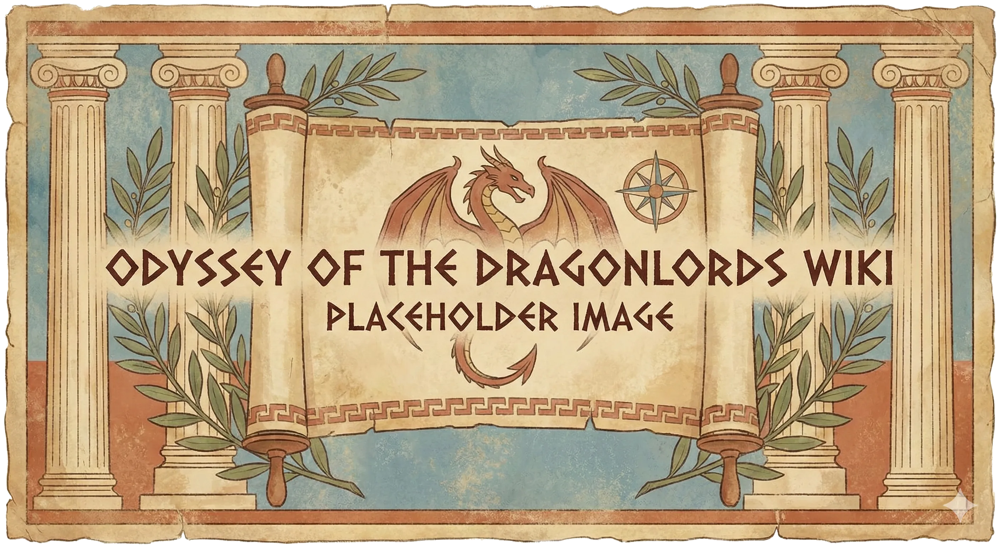

Duży budynek o wzmocnionych kamiennych ścianach i gontowym dachu, położony blisko centrum miasta. Wewnątrz panuje żar od ognia płonącego w wielkim palenisku.

W sesjach pod tą nazwą występuje też wulkaniczna góra [[Volkan|Volkana]] (Góra Volkana, Mount Volkan), na którą wyrusza procesja Wielkich Igrzysk i która po śmierci [[Sydon|Sydona]] zaczęła się budzić.

## Ciekawe Miejsca
- **Warsztat**: Miejsce ozdobione brązowymi pancerzami, bronią i narzędziami rolniczymi.
- **Palenisko**: Wielka kuźnia na tyłach hali.

## Mieszkańcy
- **[[Volkan]]**: Kowal i Bóg Kuźni. Miejscowi uważają go za dziwaka z urojeniami wielkości, ale cenią jego fach. Po wojnie osiadł u boku [[Orestes|Orestesa]] w [[Orestessos Zythikē]].
- **Theo**: Młody chłopak, asystent Volkana, zajmujący się stajniami i sprawunkami.

## Historia
Główny warsztat rzemieślniczy w [[Estoria|Estorii]]. Volkan oferuje tu usługi kowalskie dla całego miasta i okolicznych farm. To tutaj można nabyć bardziej zaawansowany ekwipunek, którego nie ma na [[Agora w Estorii|Agorze]].

W [[Sesja 14 - Burza nad Mytros]] bohaterowie wraz z [[Vallus]] i [[Kyrah]] udali się na Górę Volkana, gdzie przeprowadzili rytuał mający powstrzymać burzę.

W [[Sesja 25 - Inauguracja Wielkich Igrzysk]] procesja z inauguracji Wielkich Igrzysk wspinała się z miasta na górę Volkan.

W [[Sesja 80 - Bitwa o Mytros: Śmierć Pana Burz]] po śmierci [[Sydon|Sydona]] ziemią wstrząsnęło trzęsienie, a z oddalonego szczytu Mount Volkan zaczął unosić się gęsty dym i płomienie. W [[Sesja 81 - Bitwa o Mytros: Koszmar na Targu Minotaurów]] góra Volkan zaczęła się budzić i wybuchać, co zaniepokoiło [[Lutheria|Lutherię]].

W [[Sesja 84 - Świt Nowej Ery]] [[Volkan]], po kilku latach kierowania odbudową i naprawami, osiadł u boku [[Orestes|Orestesa]] w [[Orestessos Zythikē]], gdzie razem budują kadzie. Obowiązki Volkana przy kowadle przejął cyklop [[Bront]] — uwolniony niegdyś z lochów [[Więzienie Kieł|Kła]] — i okazał się kowalem na tyle dobrym, że godnie zastąpił boga (recap wspomina o tym przy [[Mithralowa Kuźnia|Mithralowej Kuźni]]).
