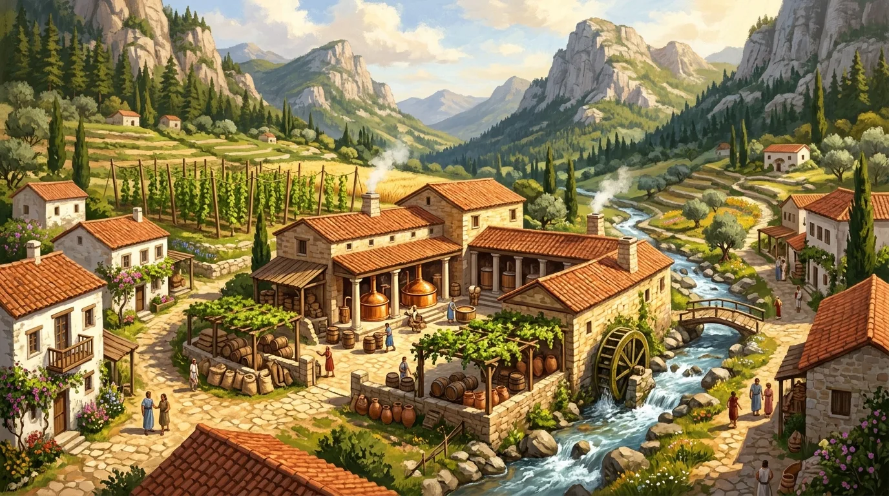

Osada na [[Kontynent Thylea|kontynencie Thylei]], znana wcześniej jako **Rosos**, po wojnie przemianowana na cześć [[Orestes|Orestesa]] i jego rzemiosła — nazwę można tłumaczyć jako „Orestesja Piwowarska". Nikt nie potrafił jej poprawnie wymówić, ale trafiła na mapy. Pod patronatem minotaura miasto rozkwitło, rośnie w siłę i bogactwo, i stało się stolicą rzemiosła piwowarskiego całej Thylei.

## Ciekawe Miejsca
- **Browar Orestesa**: serce osady i powód jej nowej nazwy. Założył go [[Silenos]], który pozostaje głównym udziałowcem, ale browarem i siecią WCSB zarządza [[Orestes]]. [[Orestes]] rozdzielał w nim udziały między towarzyszy — [[Pholon|Pholonowi]] przypadło jakieś dwanaście i pół procent, co [[Arevon Elorrenthi|Arevon]] skwitował uwagą o rodzącym się komunizmie.
- **Kadzie Volkana**: [[Volkan]] i [[Orestes]] wspólnie budują tu kadzie do browaru.
- **Bar przyzakładowy**: kuchnią rządzi kozioł [[Ramsus|Gordon]], który ułożył menu oparte na łączeniu potraw z różnymi gatunkami piwa.
- Browar prowadzi też interesy z rodziną [[Taran Neurdagon|Neurdagonów]].
- Stąd rozchodzi się po całej Thylei sieć pubów **Warlock Circus Super Bar** (WCSB), której prezesem jest [[Orestes]].

## Mieszkańcy
- [[Orestes]] — właściciel browaru i patron osady.
- [[Zythion]] — syn Orestesa i Amazonki [[Alkippe]], wychowywany w browarze.
- [[Krithon]] — daleki kuzyn i uczeń Orestesa, twórca piwa jęczmiennego leżakowanego w beczkach po winie.
- [[Pholon]] — współudziałowiec browaru.
- [[Volkan]] — bóg kowalstwa, który po latach kierowania odbudową [[Mytros]] osiadł tu u boku minotaura.

## Historia
W czasie wyprawy bohaterów mówiono już o browarze Orestesa w Rosos, którego piwo trafiało do Estorii i Mytros (wzmianki w [[Sesja 41 - Wiedźma Lotosu]] i [[Sesja 70 - Audiencja u Pani Snów]]).

W [[Sesja 84 - Świt Nowej Ery]] [[Volkan]] — po tym, jak przez pierwsze lata kierował odbudową i naprawami — znalazł dla siebie miejsce u boku [[Orestes|Orestesa]] w osadzie zwanej niegdyś Rosos, przemianowanej z czasem na cześć minotaura i jego rzemiosła: Orestessos Zythikē, czyli Orestesja Piwowarska. Nazwy nikt nie potrafił wymówić, ale trafiła na mapy.

Jedna z eksperymentalnych kadzi Orestesa i Volkana wybuchła, zalewając część miasta gorącą brzeczką; przez miesiąc całe Orestessos pachniało słodkim słodem, a sprzątanie przypominało czyszczenie stajni Augiasza. Moda na piwo z Orestessos i puby WCSB doprowadzają do bankructwa winiarzy z innych miast, którzy szczerze nienawidzą Orestesa.
