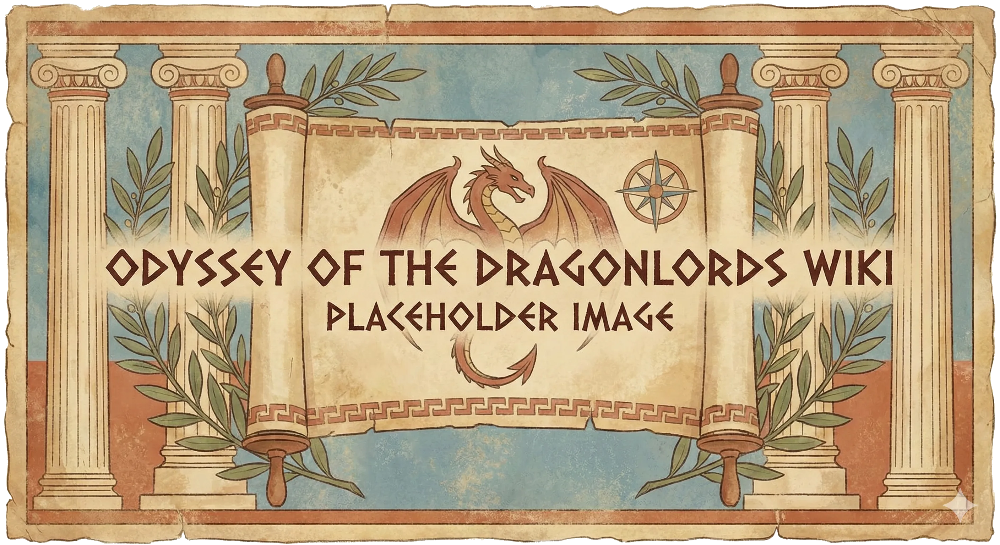

_Rzeka na [[Półwysep Arezyjski|Półwyspie Arezyjskim]], u której ujścia leży [[Arezja]]._

## Opis
Statki płynące do [[Arezja|Arezji]] wchodzą w ujście Thrake i dalej rzeką do arezyjskiego portu. Tą drogą płyną do miasta barki z rudą żelaza z [[Wyspa Indygo|Wyspy Indygo]].

## Historia
W [[Sesja 62 - Arezyjska Dyplomacja]] [[Bohaterowie Przepowiedni]] zbliżyli się do Arezji od ujścia Thrake. Miasto nie pozwoliło wpłynąć do portu [[Ultros|Ultrosem]] i latającą fortecą, więc drużyna zakotwiczyła statki niedaleko ujścia i dopłynęła szalupami.

W [[Sesja 85 - Cienie nad Arezją]] statki [[Taran Neurdagon|Tarana Neurdagona]] stanęły u ujścia rzeki i zablokowały ruch morski do Arezji.
