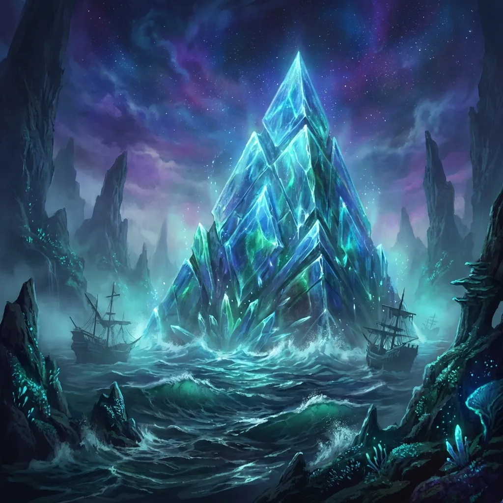

Lustrzane Więzienie, znane też jako Krystaliczna Piramida, to niezwykła struktura znajdująca się na wodach [[Morze Otchłani|Morza Otchłani]] — według [[Sesja 66 - Przebudzenie Bestii i Cienie Otchłani|Sesji 66]] dawne leże Krakena. Jest to wielka piramida wykonana z mieniącego się kryształu, częściowo zanurzona w morzu. Jej ściany odbijają światło latarni [[Ultros|Ultrosa]] tysiącem barw. Od [[Sesja 67 - Zguba Estora|Sesji 67]] jest opustoszała: obie formy [[Hezzebal]]a zniszczono, a skarbiec zdobyła drużyna.

Wnętrze budowli to labirynt luster pokrywających ściany, podłogę i sufit. Odbicia w nich są zniekształcone, niepokojące i magiczne – mogą ukazywać alternatywne wersje rzeczywistości, a nawet fizycznie wpływać na obserwatora, zmieniając go w to, co widzi.

## Ciekawe Miejsca
- **Skarbiec Hezzebala**: Centralna komnata, w której spoczywały szkielet smoka oraz góry złota, platyny, klejnotów i magicznych przedmiotów, w tym [[Skarby Smoczych Lordów]]. Drużyna zabrała stąd łupy, a [[Xiphos of Slaughter]] trafił do rąk [[Versir|Versira]].

## Mieszkańcy
Szczątki mosiężnego smoka [[Hezzebal]]a i jego jeźdźca [[Gregor Huorath|Gregora Huoratha]] spoczywały tu wraz ze skarbami Smoczych Lordów. Z szkieletu Hezzebala wyłonił się jego duch, strzegący skarbca i oskarżający Zakon o zdradę i porzucenie.

Z czasem lustra wypaczyły Hezzebala i doprowadziły go do szaleństwa.

## Historia
Więzienie stało się miejscem spoczynku [[Gregor Huorath|Gregora Huoratha]] i jego wierzchowca, [[Hezzebal]]a, przed wiekami. [[Estor Arkelander|Estor]] wysłał ich tu, by ukryli [[Skarby Smoczych Lordów]].

Hezzebal pozostał w piramidzie, strzegąc skarbów i oskarżając Zakon o zdradę i porzucenie.

W [[Sesja 66 - Przebudzenie Bestii i Cienie Otchłani]] duch Estora wskazał „dawne leże Krakena” jako miejsce, gdzie spoczywają szczątki Gregora i Hezzebala wraz ze skarbami Smoczych Lordów oraz jego dawny miecz.

W [[Sesja 67 - Zguba Estora]] załoga Ultrosa dotarła do piramidy. Drużyna zbadała labirynt luster, które niosły ryzyko fizycznej i mentalnej transformacji: [[Orestes]] przybrał diaboliczną postać z płonącymi rogami, a [[Versir]] stracił kości i został magicznie uleczony. W skarbcu z kości smoka wyłonił się duch Hezzebala, który walczył w dwóch formach naraz — jako eteryczny duch i ożywiony szkielet — i oskarżył Zakon o zdradę. Gdy w skarbcu zmaterializował się [[Estor Arkelander|Estor]] z odzyskanym mieczem [[Xiphos of Slaughter]], Hezzebal wpadł w amok na widok swego dawnego pana i mordercy. Drużyna roztrzaskała szkielet i rozwiała ducha smoka, a następnie pokonała Estora, którego duszę wchłonął Xiphos. Drużyna zdobyła skarby Smoczych Lordów.
