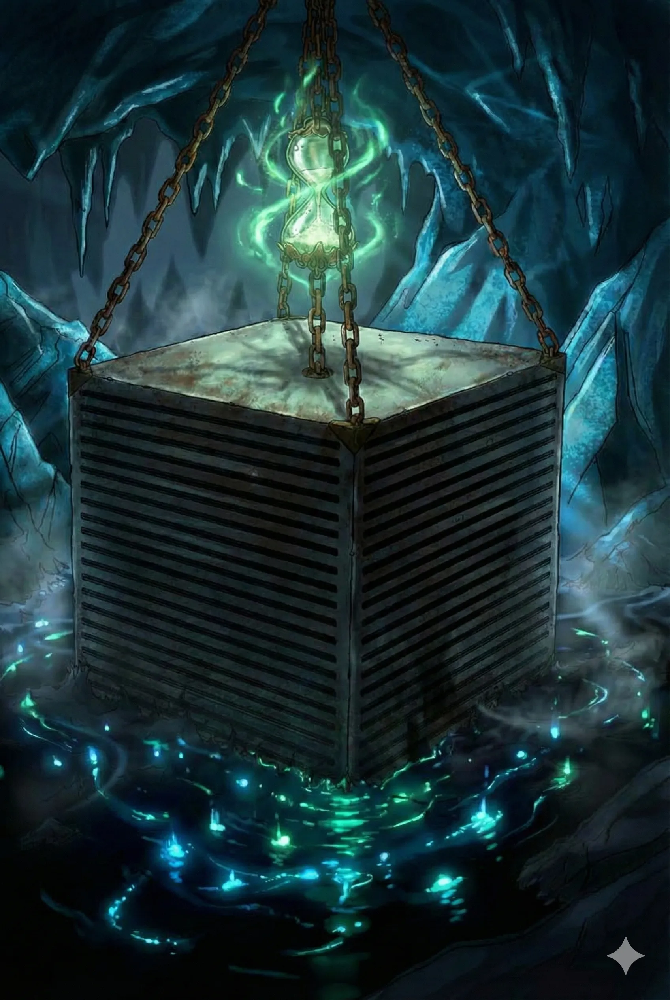

_Gigantyczny, lewitujący sześcian na łańcuchach z adamantu, będący więzieniem dla najgroźniejszej istoty w Thylei. W Morzu Otchłani lewitują dwa takie identyczne sześciany._

## Opis
Sześcian o boku około 35 metrów, zawieszony na pięciu łańcuchach z adamantu nad wyspą z czerwonym jeziorem (wypełnionym krwią tysiąca bazyliszków). Na jednym z łańcuchów wisi klepsydra odliczająca czas (pozostało około 300 lat).

Wejście do sześcianu zabezpieczone jest hasłem („Thanatos”); drugi, identyczny sześcian ma inne hasło i pozostał zamknięty. Wnętrze to labirynt korytarzy i komnat chronionych przez golemy i śmiercionośne pułapki.

Wewnątrz znajdują się:
*   Komnata z czterema lewitującymi zielonymi sferami i runami Primordial.
*   Sala z lewitującą czarną kulą (sfera anihilacji), która pozbawiła [[Versir|Versira]] ręki.
*   Główna komora więzienna skrywająca uśpionego [[Tarrasque]].
*   Czerwie (Purple Worms): dwa dorosłe zakute w łańcuchy oraz młode, zamknięte za kratą otwieraną dźwignią.
*   Pomieszczenie ze zbiornikiem kwasu, którego rury prowadzą do komory Tarrasque.

## Mieszkańcy
-   **[[Tarrasque]]**: Tytaniczny potwór, uśpiony do [[Sesja 66 - Przebudzenie Bestii i Cienie Otchłani|Sesji 66]], gdy został przypadkowo obudzony.
-   **Golemy**: Strażnicy sześcianu, potrafiący dostosowywać swój wygląd do atakujących.
-   **Czerwie (Purple Worms)**: Przetrzymywane w łańcuchach.
-   **[[The Keeper]]**: Ultroloth, znużony i cyniczny zarządca więzienia.

## Historia
Sześcian jest miejscem, gdzie uwięziono „Zgubę Bogów” — zrodzonego z pustki pożeracza światów, przed którym drżą Tytani.

W [[Sesja 65 - Wyprawa w Otchłań]] Bohaterowie Przepowiedni zinfiltrowali sześcian. Odkryli jego przerażającą zawartość oraz stracili (Versir) rękę w kontakcie z jedną z magicznych sfer. Wydobyli stąd również wiedzę o istnieniu Tarrasque'a.

W [[Sesja 66 - Przebudzenie Bestii i Cienie Otchłani]] wewnątrz sześcianu doszło do bitwy z konstruktami i czerwiami. [[Felicjan Janus Twardowski|Felicjan]] przejął kontrolę nad jedną ze Sfer Anihilacji, używając jej do niszczenia wrogów. Przez splot niefortunnych zdarzeń (zrzucenie czerwi, fala gromu Oriona), **[[Tarrasque]] został przebudzony**. Wstrząsy targnęły całym sześcianem, a drużyna uciekła na [[Ultros]]. Zarządca sześcianu, [[The Keeper]] (ultroloth), zaproponował układ: jeśli bohaterowie w przyszłości dostarczą mu [[Kryształowa Kosa Lutherii|Kosę Lutherii]], pomoże im w ostatecznym rozwiązaniu problemu uwolnionego Tarrasque'a. Felicjan zostawił na schodach magiczne oko, które pokazało jedynie, jak The Keeper opuszcza sześcian i wita się z nowo przybyłą postacią.

W [[Sesja 84 - Świt Nowej Ery]] [[Versir]] obiecał przez najbliższe miesiące, a może i lata, zaglądać do więziennych sześcianów; nic tam się nie zmieniało i nic nie zapowiadało zmiany.
